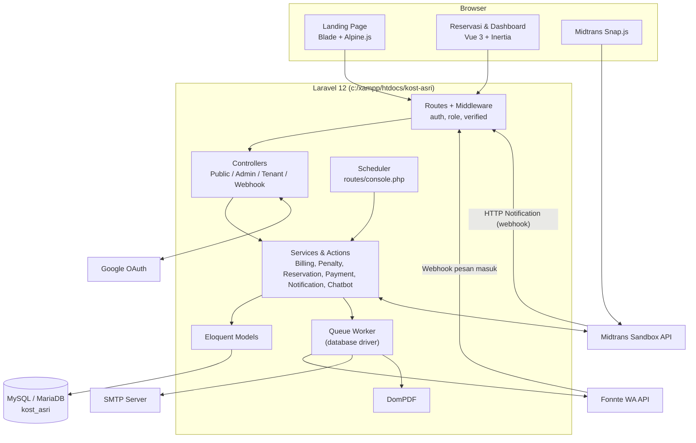
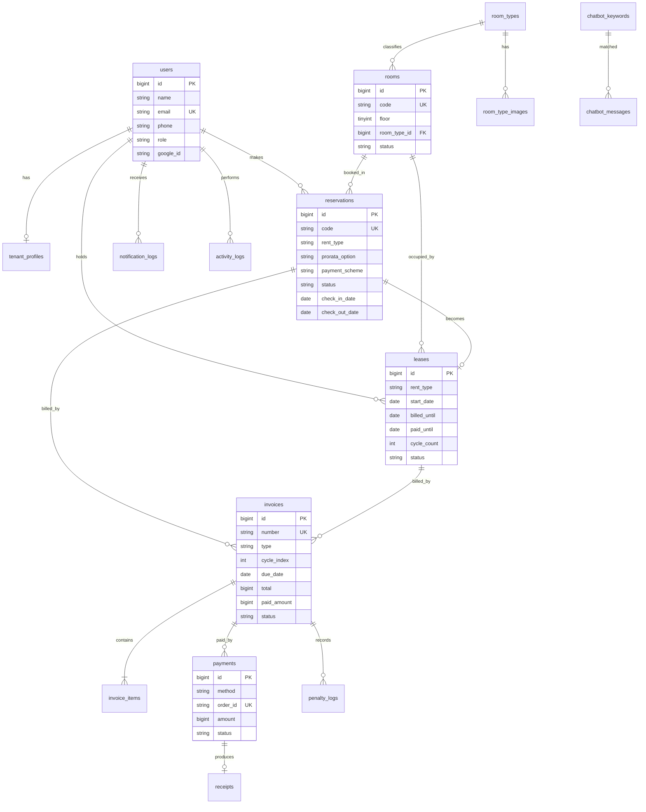
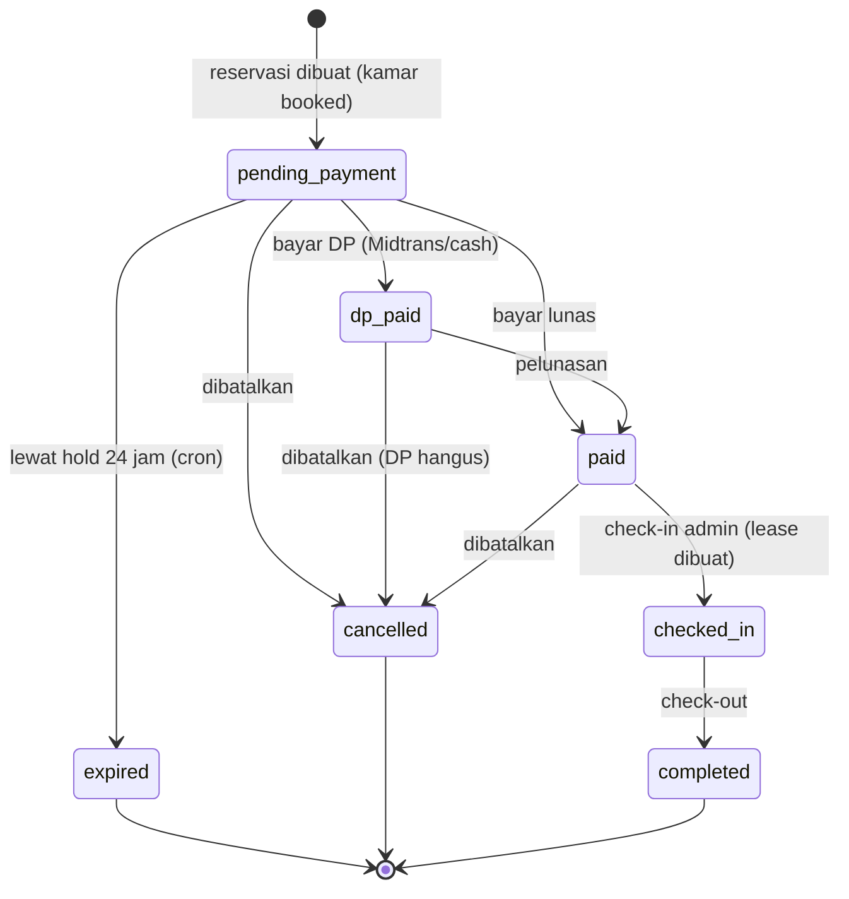
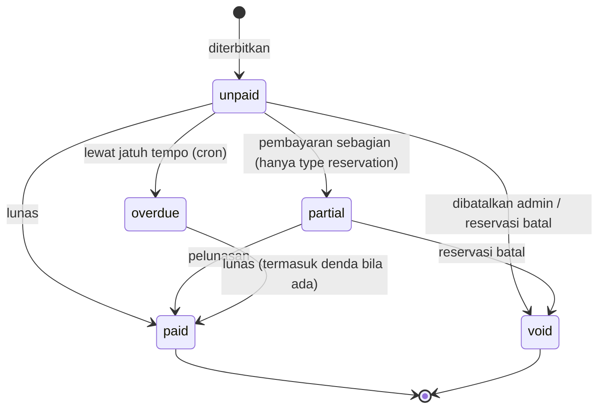
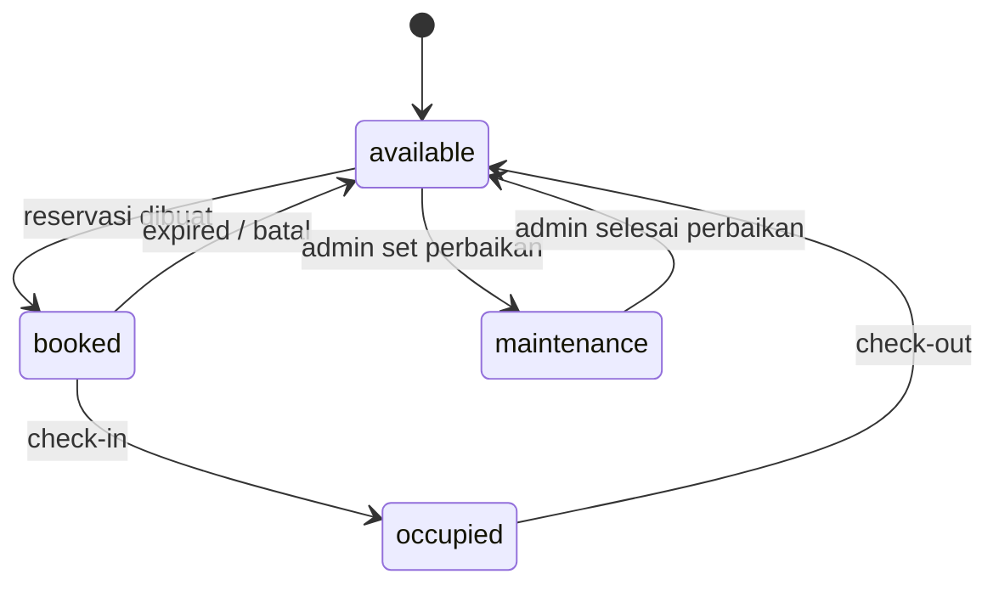
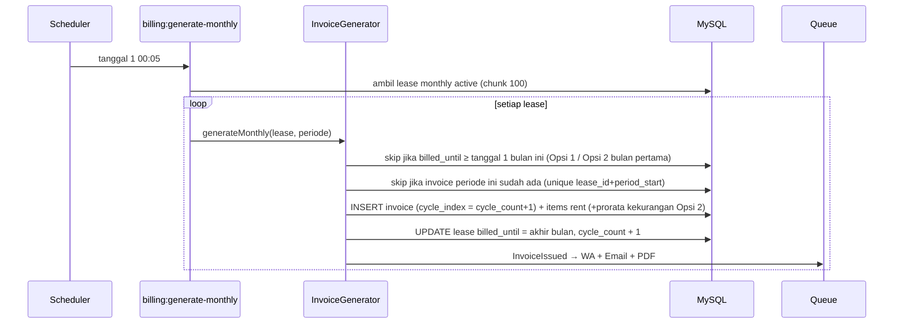
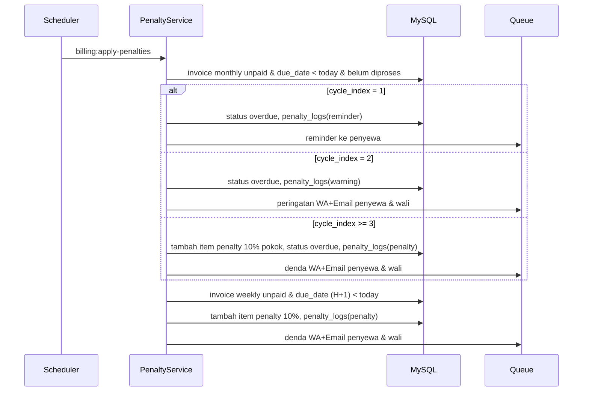
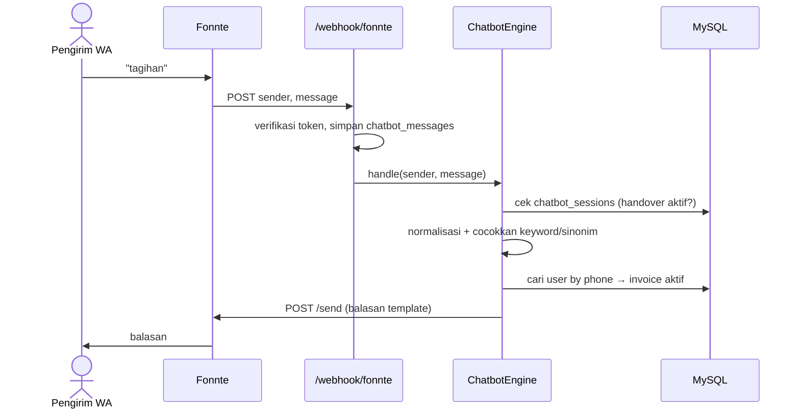
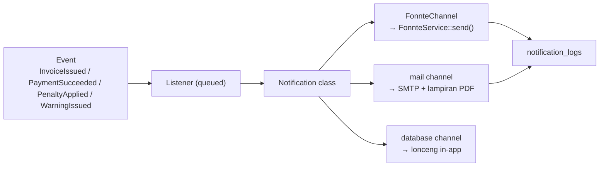

# Blueprint Teknis — Mini ERP Kost ASRI BOARDING HOUSE

| Atribut | Nilai |
|---|---|
| Versi | 1.0 |
| Tanggal | 08 November 2026 |
| Fase Waterfall | 2 — Design |
| Sumber Requirement | [PRD-Kost-Asri.md](../Documentation/PRD-Kost-Asri.md) (ID `FR-*` & `BR-*`) |
| Detail Database | [Task-Database.md](../Task/Task-Database.md) |
| Detail Desain UI | [Task-Desain.md](../Task/Task-Desain.md) |

---

## Daftar Isi
1. [Arsitektur Sistem](#1-arsitektur-sistem)
2. [Tech Stack & Paket](#2-tech-stack--paket)
3. [Struktur Folder Project](#3-struktur-folder-project)
4. [Model Data (ERD Ringkas)](#4-model-data-erd-ringkas)
5. [Enum & Status](#5-enum--status)
6. [State Machine](#6-state-machine)
7. [Peta Rute & Middleware](#7-peta-rute--middleware)
8. [Sequence Diagram Proses Kunci](#8-sequence-diagram-proses-kunci)
9. [Mesin Billing (Pseudocode)](#9-mesin-billing-pseudocode)
10. [Scheduler, Queue & Notifikasi](#10-scheduler-queue--notifikasi)
11. [Chatbot Engine](#11-chatbot-engine)
12. [Keamanan](#12-keamanan)
13. [Konfigurasi Environment](#13-konfigurasi-environment)
14. [Strategi Deployment](#14-strategi-deployment)
15. [Pemetaan Dokumen Task](#15-pemetaan-dokumen-task)

---

## 1. Arsitektur Sistem

Monolith **Laravel 12** dengan dua lapisan presentasi:
- **Publik (SEO-friendly)**: Blade + Alpine.js + Tailwind — landing page & halaman informasi.
- **Aplikasi (SPA-like)**: Inertia.js + Vue 3 — wizard reservasi, dashboard Admin & Penyewa.



### 1.1 Prinsip Desain Kode
| Prinsip | Penerapan |
|---|---|
| Thin controller | Controller hanya validasi (FormRequest), otorisasi (Policy), memanggil Service/Action, mengembalikan Inertia/Blade response |
| Service layer | Logika bisnis (billing, denda, reservasi) di `app/Services` — mudah di-unit test |
| Action class | Operasi tunggal transaksional (`CreateReservationAction`, `CheckInAction`) di `app/Actions` |
| Enum PHP 8.1+ | Semua status disimpan string, dipetakan ke `app/Enums` (backed enum) |
| Event-driven notifikasi | Event (`PaymentSucceeded`, `InvoiceIssued`) → Listener queued → Notification channel WA/Email |
| Money sebagai integer | Rupiah disimpan `BIGINT UNSIGNED` (tanpa desimal) untuk menghindari floating point |
| Idempotensi | Webhook & command cron aman dijalankan berulang (cek state sebelum mutasi, unique key) |

## 2. Tech Stack & Paket

### 2.1 Backend (Composer)
| Paket | Fungsi | Dipakai di FR |
|---|---|---|
| `laravel/framework` ^12 | Core framework | semua |
| `inertiajs/inertia-laravel` ^2 | Adapter Inertia | Dashboard, Reservasi |
| `tightenco/ziggy` | Route Laravel di Vue (`route()`) | Frontend |
| `laravel/socialite` ^5 | Google OAuth | FR-AUTH-03 |
| `midtrans/midtrans-php` ^2 | Snap token, status API | FR-PAY-01, FR-PAY-02, FR-CRON-06 |
| `barryvdh/laravel-dompdf` ^3 | Nota, invoice, kwitansi PDF | FR-PDF-01..03, FR-DASH-02 |
| `intervention/image` ^3 | Kompres & thumbnail gambar CMS | FR-CMS-* |
| `pestphp/pest` + `pest-plugin-laravel` (dev) | Testing | Task-Testing |
| `laravel/pint` (dev) | Code style PSR-12 | NFR-10 |

> Fonnte & SMTP tidak memerlukan paket khusus: Fonnte via `Illuminate\Support\Facades\Http`, SMTP via Laravel Mail bawaan.

### 2.2 Frontend (npm)
| Paket | Fungsi |
|---|---|
| `vue` ^3, `@inertiajs/vue3` ^2 | SPA dashboard & wizard |
| `tailwindcss` ^4, `@tailwindcss/vite` | Utility CSS + design token (`@theme`) |
| `alpinejs`, `@alpinejs/intersect`, `@alpinejs/collapse` | Animasi landing (reveal on scroll, accordion FAQ, slider) |
| `@fontsource-variable/plus-jakarta-sans` | Font self-hosted |
| `lucide-vue-next` | Ikon dashboard |
| `chart.js` + `vue-chartjs` | Grafik laporan |
| `dayjs` | Format tanggal Indonesia di sisi klien |

## 3. Struktur Folder Project

```text
kost-asri/
├── Blueprint/                      # dokumen ini
├── Documentation/                  # PRD
├── Task/                           # checklist Waterfall
├── app/
│   ├── Actions/
│   │   ├── Reservation/            # CreateReservationAction, CancelReservationAction, ExpireReservationAction
│   │   ├── Stay/                   # CheckInAction, CheckOutAction, ExtendDailyStayAction
│   │   └── Payment/                # RecordCashPaymentAction, ApplyPaymentAction
│   ├── Console/Commands/           # GenerateMonthlyInvoices, GenerateWeeklyInvoices, ApplyPenalties, ...
│   ├── Enums/                      # UserRole, RoomClass, RoomStatus, RentType, ProrataOption, ...
│   ├── Events/                     # ReservationCreated, InvoiceIssued, PaymentSucceeded, InvoiceOverdue ...
│   ├── Listeners/                  # SendReservationNotifications, SendPaymentReceipt, ...
│   ├── Http/
│   │   ├── Controllers/
│   │   │   ├── Public/             # LandingController, AvailabilityController
│   │   │   ├── Auth/               # GoogleController (+ auth starter kit)
│   │   │   ├── Reservation/        # ReservationWizardController
│   │   │   ├── Admin/              # Dashboard, Room, RoomType, Reservation, Tenant, Invoice, Payment, Cms/*, Chatbot, Report, Setting
│   │   │   ├── Tenant/             # Dashboard, Invoice, Profile, Extension, Testimonial
│   │   │   └── Webhook/            # MidtransWebhookController, FonnteWebhookController
│   │   ├── Middleware/             # EnsureRole, EnsureProfileComplete
│   │   └── Requests/               # FormRequest per aksi
│   ├── Models/
│   ├── Notifications/              # InvoiceIssuedNotification, PenaltyAppliedNotification, ... (+ channel Fonnte)
│   │   └── Channels/FonnteChannel.php
│   ├── Policies/                   # ReservationPolicy, InvoicePolicy, LeasePolicy
│   ├── Services/
│   │   ├── Billing/                # PriceCalculator, ProrataCalculator, InvoiceGenerator, PenaltyService
│   │   ├── Payment/                # MidtransService, PaymentService
│   │   ├── Notification/           # FonnteService, TemplateRenderer
│   │   ├── Chatbot/                # ChatbotEngine, KeywordMatcher
│   │   ├── Pdf/                    # PdfService
│   │   └── Setting/                # SettingService (cache)
│   └── Support/                    # Money (format Rupiah, terbilang), NumberSequence
├── database/
│   ├── migrations/
│   ├── seeders/                    # RoomTypeSeeder, RoomSeeder (32), AdminSeeder, CmsSeeder, SettingSeeder, ChatbotSeeder
│   └── factories/
├── resources/
│   ├── css/
│   │   ├── app.css                 # Tailwind + token (dashboard)
│   │   └── public.css              # Tailwind + token biophilic (landing)
│   ├── js/
│   │   ├── app.js                  # Inertia bootstrap
│   │   ├── public.js               # Alpine bootstrap
│   │   ├── Layouts/                # GuestLayout, AdminLayout, TenantLayout, ReservationLayout
│   │   ├── Components/             # StatusBadge, RoomClassBadge, RupiahText, RoomGrid, BentoCard, DataTable, Modal, Stepper
│   │   ├── Composables/            # useRupiah, useSnap, useFilters
│   │   └── Pages/
│   │       ├── Reservation/        # Step1Room, Step2Rent, Step3Profile, Step4Payment, Step5Done
│   │       ├── Account/            # Reservasi saya (calon penyewa)
│   │       ├── Admin/              # Dashboard, Rooms, Reservations, Tenants, Invoices, Payments, Cms/*, Chatbot, Reports, Settings
│   │       └── Tenant/             # Dashboard, Invoices, Profile, Extension
│   └── views/
│       ├── public/                 # landing.blade.php + partials/sections/*
│       ├── pdf/                    # reservation-note, invoice, receipt, report
│       ├── emails/                 # markdown mail templates
│       └── app.blade.php           # root Inertia
├── routes/
│   ├── web.php                     # publik, auth, reservasi, admin, tenant
│   ├── webhook.php                 # midtrans, fonnte (tanpa CSRF)
│   └── console.php                 # jadwal scheduler
├── storage/app/private/ktp/        # foto KTP (privat)
└── tests/
    ├── Unit/Billing/
    └── Feature/
```

## 4. Model Data (ERD Ringkas)

Kamus data lengkap (kolom, tipe, index) ada di [Task-Database.md](../Task/Task-Database.md).



Tabel CMS (berdiri sendiri): `facilities`, `galleries`, `videos`, `reservation_steps`, `testimonials`, `faqs`, `nearby_places`, `site_settings`. Tabel sistem: `settings`, `notification_templates`, `chatbot_sessions`, `webhook_logs`, `jobs`, `failed_jobs`, `cache`, `sessions`.

## 5. Enum & Status

| Enum (`app/Enums`) | Nilai | Label UI | Warna |
|---|---|---|---|
| `UserRole` | `admin`, `penyewa`, `calon_penyewa` | Admin, Penyewa Aktif, Calon Penyewa | — |
| `RoomClass` | `standard`, `vip`, `deluxe` | Standard, VIP, Deluxe | abu-abu, biru, emas |
| `RoomStatus` | `available`, `booked`, `occupied`, `maintenance` | Tersedia, Dipesan (DP), Terisi, Perbaikan | hijau, kuning, merah, netral |
| `RentType` | `daily`, `weekly`, `monthly` | Harian, Mingguan, Bulanan | — |
| `ProrataOption` | `combined`, `full_first` | Opsi 1 Gabung, Opsi 2 Penuh Dulu | — |
| `PaymentScheme` | `dp`, `full` | DP, Lunas | — |
| `ReservationSource` | `online`, `admin` | Online, Manual Admin | — |
| `ReservationStatus` | `pending_payment`, `dp_paid`, `paid`, `checked_in`, `completed`, `cancelled`, `expired` | Menunggu Bayar, DP Dibayar, Lunas, Check-in, Selesai, Batal, Kedaluwarsa | netral, kuning, hijau, hijau tua, netral, merah muda, netral |
| `LeaseStatus` | `active`, `ending`, `ended` | Aktif, Akan Berakhir, Selesai | hijau, kuning, netral |
| `InvoiceType` | `reservation`, `settlement`, `monthly`, `weekly`, `daily_extension` | Reservasi, Pelunasan, Bulanan, Mingguan, Tambah Hari | — |
| `InvoiceStatus` | `unpaid`, `partial`, `paid`, `overdue`, `void` | Belum Bayar, DP/Sebagian, Lunas, Menunggak, Dibatalkan | netral, kuning, hijau, merah, netral |
| `InvoiceItemType` | `rent`, `prorata`, `penalty`, `discount`, `other` | Sewa, Prorata, Denda, Diskon, Lain-lain | — |
| `PaymentMethod` | `midtrans`, `cash` | Midtrans, Tunai | — |
| `PaymentStatus` | `pending`, `paid`, `failed`, `needs_review` | Menunggu, Berhasil, Gagal, Perlu Ditinjau | kuning, hijau, merah, netral |
| `PenaltyAction` | `reminder`, `warning`, `penalty`, `waived` | Reminder, Peringatan, Denda, Dibebaskan | — |
| `NotificationChannel` | `whatsapp`, `email`, `database` | — | — |

## 6. State Machine

### 6.1 Reservasi


### 6.2 Invoice


### 6.3 Kamar


> Status kamar `booked`/`occupied` adalah **status saat ini**. Ketersediaan untuk tanggal masa depan selalu dihitung dari irisan tanggal reservasi/lease (BR-01), sehingga kamar yang terisi bulan ini tetap bisa dipesan untuk tanggal setelah lease berakhir (jika lease memiliki tanggal akhir).

## 7. Peta Rute & Middleware

### 7.1 Publik & Auth
| Method | URI | Controller@aksi | Middleware | FR |
|---|---|---|---|---|
| GET | `/` | `Public\LandingController@index` | — | FR-CMS-10 |
| GET | `/kamar/{roomType:slug}` | `Public\LandingController@roomType` | — | FR-CMS-02 |
| GET | `/api/availability` | `Public\AvailabilityController@index` | throttle:60,1 | FR-ROOM-04 |
| GET | `/auth/google/redirect` | `Auth\GoogleController@redirect` | guest | FR-AUTH-03 |
| GET | `/auth/google/callback` | `Auth\GoogleController@callback` | guest | FR-AUTH-03 |
| — | `/login`, `/register`, `/forgot-password`, `/verify-email` | bawaan starter kit | guest/auth | FR-AUTH-01,02,04 |
| GET/POST | `/akun/lengkapi-profil` | `Account\ProfileCompletionController` | auth | FR-AUTH-07 |
| GET | `/akun/reservasi-saya` | `Account\ReservationController@index` | auth, role:calon_penyewa,penyewa | FR-RSV-08 |

### 7.2 Wizard Reservasi
| Method | URI | Aksi | Middleware | FR |
|---|---|---|---|---|
| GET | `/reservasi` | Step 1 pilih kamar | — | FR-RSV-01 |
| POST | `/reservasi/kamar` | simpan draft step 1 | — | FR-RSV-01 |
| GET/POST | `/reservasi/sewa` | Step 2 tipe & durasi | — | FR-RSV-02 |
| POST | `/reservasi/hitung` | kalkulasi harga (JSON) | throttle | FR-RSV-02 |
| GET/POST | `/reservasi/data-diri` | Step 3 | auth, verified | FR-TNT-01 |
| GET/POST | `/reservasi/pembayaran` | Step 4, buat reservasi | auth, verified, profile.complete | FR-RSV-03, FR-PAY-01 |
| GET | `/reservasi/{reservation:code}/selesai` | Step 5 | auth, can:view | FR-PDF-01 |
| POST | `/invoices/{invoice}/snap-token` | ambil/buat Snap token | auth, can:pay | FR-PAY-01 |
| GET | `/invoices/{invoice}/pdf` | unduh PDF | auth, can:view | FR-PDF-02 |
| GET | `/receipts/{receipt}/pdf` | unduh kwitansi | auth, can:view | FR-PDF-03 |

### 7.3 Admin (`/admin`, middleware `auth, verified, role:admin`)
| Resource | URI | Fitur | FR |
|---|---|---|---|
| Dashboard | `/admin/dashboard` | KPI bento | FR-DASH-01 |
| Denah | `/admin/rooms/map` | denah 2 lantai | FR-ROOM-03 |
| Tipe kamar | `/admin/room-types` (resource) | CRUD + tarif + foto | FR-ROOM-01, FR-CMS-02 |
| Kamar | `/admin/rooms` (resource) | CRUD, maintenance | FR-ROOM-02 |
| Reservasi | `/admin/reservations` (resource) + `POST {id}/check-in`, `POST {id}/cancel` | manual, check-in, batal | FR-RSV-05..08 |
| Lease | `/admin/leases` + `POST {id}/check-out`, `POST {id}/extend` | huni aktif | FR-RSV-07, FR-RSV-09 |
| Penyewa | `/admin/tenants` | data & wali | FR-DASH-06 |
| Invoice | `/admin/invoices` + `POST {id}/items`, `POST {id}/void`, `POST {id}/waive-penalty`, `POST {id}/resend` | penagihan | FR-BILL-06, FR-BILL-07, FR-PEN-04 |
| Pembayaran | `/admin/payments` + `POST /admin/invoices/{id}/cash` | cash & riwayat | FR-PAY-03 |
| CMS | `/admin/cms/{facilities,galleries,videos,steps,testimonials,faqs}` (resource) + `/admin/cms/location`, `/admin/cms/about`, `POST /admin/cms/{type}/reorder` | konten landing | FR-CMS-01..09 |
| Chatbot | `/admin/chatbot/keywords` (resource), `/admin/chatbot/messages` | keyword & log | FR-BOT-05 |
| Notifikasi | `/admin/notifications` + `POST {id}/resend` | log | FR-NTF-04 |
| Laporan | `/admin/reports/{revenue,arrears,occupancy}` + `?export=pdf|csv` | laporan | FR-DASH-02 |
| Pengaturan | `/admin/settings`, `/admin/settings/templates` | parameter & template | FR-DASH-04 |
| Log | `/admin/activity-logs` | audit | FR-DASH-05 |

### 7.4 Penyewa Aktif (`/penyewa`, middleware `auth, verified, role:penyewa`)
| URI | Fitur | FR |
|---|---|---|
| `/penyewa/dashboard` | kamar, masa sewa, tagihan aktif | FR-DASH-03 |
| `/penyewa/tagihan` | daftar invoice + bayar | FR-TNT-02, FR-PAY-01 |
| `/penyewa/perpanjang` | tambah hari (harian) / tidak perpanjang (mingguan) / ajukan berhenti (bulanan) | FR-RSV-09, FR-TNT-04 |
| `/penyewa/profil` | profil & data wali | FR-TNT-01 |
| `/penyewa/testimoni` | kirim testimoni | FR-TNT-03 |

### 7.5 Webhook (`routes/webhook.php`, tanpa CSRF, throttle)
| Method | URI | Verifikasi | FR |
|---|---|---|---|
| POST | `/webhook/midtrans` | `signature_key` SHA512 | FR-PAY-02 |
| POST | `/webhook/fonnte` | token rahasia di query (`?token=`) dibandingkan `FONNTE_WEBHOOK_SECRET` | FR-BOT-01 |

### 7.6 Middleware Kustom
| Alias | Class | Fungsi |
|---|---|---|
| `role` | `EnsureRole` | `role:admin` / `role:penyewa,calon_penyewa` → 403 jika tidak cocok |
| `profile.complete` | `EnsureProfileComplete` | Wajib nomor WA (+ data wali untuk mingguan/bulanan) sebelum step pembayaran |

## 8. Sequence Diagram Proses Kunci

### 8.1 Reservasi Online + Midtrans
```mermaid
sequenceDiagram
    actor U as Calon Penyewa
    participant V as Vue Wizard
    participant L as Laravel
    participant DB as MySQL
    participant M as Midtrans
    participant Q as Queue

    U->>V: Step 1-3 (kamar, sewa, data diri)
    V->>L: POST /reservasi/pembayaran (scheme, method)
    L->>DB: BEGIN; SELECT room FOR UPDATE; cek irisan tanggal
    L->>DB: INSERT reservation (pending_payment), invoice reservation (+settlement bila DP)
    L->>DB: UPDATE room status=booked; COMMIT
    L->>M: Snap::getSnapToken(order_id, gross_amount)
    M-->>L: snap_token
    L-->>V: Inertia props (snap_token)
    V->>M: snap.pay(token)
    U->>M: bayar (VA/QRIS/e-wallet)
    M->>L: POST /webhook/midtrans (settlement)
    L->>L: verifikasi signature + idempotensi
    L->>DB: payment=paid, invoice paid/partial, reservation dp_paid/paid
    L->>Q: event PaymentSucceeded
    Q->>Q: buat kwitansi PDF, kirim WA (Fonnte) & Email (SMTP)
    V->>L: GET /reservasi/{code}/selesai
    L-->>U: Step 5 + unduh nota PDF
```

### 8.2 Pembayaran Cash oleh Admin
```mermaid
sequenceDiagram
    actor A as Admin
    participant L as Laravel
    participant DB as MySQL
    participant Q as Queue
    A->>L: POST /admin/invoices/{id}/cash (nominal, catatan)
    L->>L: validasi nominal ≤ sisa; invoice non-reservation wajib = sisa
    L->>DB: INSERT payment (cash, paid, received_by); UPDATE invoice & reservation
    L->>Q: PaymentSucceeded → kwitansi PDF + WA + Email
    L-->>A: toast "Pembayaran tercatat" + link kwitansi
```

### 8.3 Generate Tagihan Bulanan (tanggal 1)


### 8.4 Eskalasi Denda (harian 00:30)


### 8.5 Chatbot


## 9. Mesin Billing (Pseudocode)

### 9.1 PriceCalculator (reservasi)
```php
// app/Services/Billing/PriceCalculator.php
public function quote(RoomType $type, RentType $rent, Carbon $checkIn, int $qty, ?ProrataOption $opt): Quote
{
    return match ($rent) {
        RentType::Daily  => Quote::items([
            Item::rent("Sewa harian {$qty} malam", $qty * $type->daily_rate),
        ]),                                                    // BR-05
        RentType::Weekly => Quote::items([
            Item::rent("Sewa mingguan {$qty} minggu", $qty * $type->weekly_rate),
        ]),                                                    // BR-08
        RentType::Monthly => $this->monthly($type, $checkIn, $opt), // BR-13..BR-15
    };
}

private function monthly(RoomType $type, Carbon $in, ?ProrataOption $opt): Quote
{
    $rate = $type->monthly_rate;
    if ($in->day === 1) {                                          // edge case: tanpa prorata
        return Quote::items([Item::rent("Sewa {$in->translatedFormat('F Y')}", $rate)])
            ->paidUntil($in->copy()->endOfMonth());
    }
    if ($opt === ProrataOption::Combined) {                        // BR-14 Opsi 1
        $days = $in->daysInMonth - $in->day + 1;
        return Quote::items([
            Item::prorata("Prorata {$in->format('d')}–{$in->daysInMonth} {$in->translatedFormat('M Y')} ({$days} hari)",
                $this->prorata($rate, $in->daysInMonth, $days)),
            Item::rent('Sewa '.$in->copy()->addMonthNoOverflow()->translatedFormat('F Y'), $rate),
        ])->paidUntil($in->copy()->addMonthNoOverflow()->endOfMonth());
    }
    // BR-15 Opsi 2: 1 bulan penuh, menutup tgl_masuk .. tgl_masuk+1bulan-1hari
    $paidUntil = $in->copy()->addMonthNoOverflow()->subDay();
    if ($in->day > $in->copy()->addMonthNoOverflow()->daysInMonth) {
        $paidUntil = $in->copy()->addMonthNoOverflow()->endOfMonth();
    }
    return Quote::items([Item::rent('Sewa 1 bulan penuh', $rate)])->paidUntil($paidUntil);
}

public function prorata(int $rate, int $daysInMonth, int $days): int
{
    return Money::round($rate / $daysInMonth * $days);            // BR-13, BR-32
}
```

### 9.2 InvoiceGenerator::generateMonthly (FR-CRON-01)
```php
public function generateMonthly(Lease $lease, Carbon $periodStart): ?Invoice
{
    // billed_until = tanggal terakhir yang SUDAH DITAGIH (bukan yang sudah dibayar),
    // diisi saat check-in dari periode tagihan reservasi, diperbarui setiap invoice terbit.
    $periodEnd = $periodStart->copy()->endOfMonth();
    if ($lease->billed_until->gte($periodEnd)) {
        return null;                                   // bulan sudah ditagih (Opsi 1) → skip
    }
    if ($lease->billed_until->gte($periodStart)) {
        // Opsi 2 bulan pertama: periode berbayar masih menutup sebagian bulan ini
        // → tanggal 1 ini DILEWATI, kekurangan ditagih tanggal 1 berikutnya (BR-15)
        return null;
    }
    if (Invoice::where('lease_id', $lease->id)->where('period_start', $periodStart)->exists()) {
        return null;                                   // idempoten (unique lease_id + period_start)
    }
    $items = [];
    $gapStart = $lease->billed_until->copy()->addDay();
    if ($gapStart->lt($periodStart)) {                 // kekurangan prorata bulan lalu (Opsi 2)
        $gapEnd = $gapStart->copy()->endOfMonth();
        $days   = $gapStart->diffInDays($gapEnd) + 1;
        $items[] = Item::prorata("Kekurangan {$gapStart->format('d')}–{$gapEnd->format('d M Y')} ({$days} hari)",
            $this->calc->prorata($lease->monthly_rate, $gapStart->daysInMonth, $days));
    }
    $items[] = Item::rent('Sewa '.$periodStart->translatedFormat('F Y'), $lease->monthly_rate);

    return DB::transaction(function () use ($lease, $periodStart, $periodEnd, $items) {
        $invoice = Invoice::createFor($lease, [
            'type'         => InvoiceType::Monthly,
            'cycle_index'  => $lease->cycle_count + 1,      // BR-17
            'period_start' => $periodStart,
            'period_end'   => $periodEnd,
            'due_date'     => $periodStart->copy()->day(setting('monthly_due_day')),   // BR-12
        ], $items);
        $lease->update(['billed_until' => $periodEnd, 'cycle_count' => $lease->cycle_count + 1]);
        return $invoice;
    });
}
```
> `billed_until` & `cycle_count` diperbarui **saat invoice terbit**; `paid_until` diperbarui **saat invoice lunas** (dipakai untuk tampilan "dibayar sampai" & laporan tunggakan). Contoh Opsi 2 (masuk 15 Nov): `billed_until = 14 Des` → 1 Des dilewati (14 Des ≥ 1 Des), 1 Jan menagih kekurangan 15–31 Des + Januari (siklus ke-1). Contoh Opsi 1: `billed_until = 31 Des` → 1 Des dilewati, 1 Jan tarif penuh (siklus ke-1).

### 9.3 PenaltyService (FR-CRON-03)
```php
public function processMonthly(Invoice $inv, Carbon $today): void
{
    if ($inv->status->isSettled() || $today->lte($inv->due_date)) return;
    if ($inv->penaltyLogs()->exists()) return;                     // idempoten: sekali per invoice

    $inv->markOverdue();
    match (true) {
        $inv->cycle_index === 1 => $this->log($inv, PenaltyAction::Reminder),          // BR-19
        $inv->cycle_index === 2 => $this->warn($inv),                                 // BR-20
        default                 => $this->charge($inv),                               // BR-20, BR-18
    };
}

private function charge(Invoice $inv): void
{
    $base   = $inv->items()->whereIn('type', ['rent', 'prorata'])->sum('amount');
    $amount = Money::round($base * setting('penalty_percent') / 100);
    $inv->addItem(Item::penalty("Denda keterlambatan {$this->pct()}%", $amount));
    $this->log($inv, PenaltyAction::Penalty, $amount);
    event(new PenaltyApplied($inv));      // → WA + Email penyewa & wali
}

public function processWeekly(Invoice $inv, Carbon $today): void
{
    // due_date = end_k + weekly_tolerance_days (H+1) — BR-10, BR-11
    if ($inv->status->isSettled() || $today->lte($inv->due_date) || $inv->penaltyLogs()->exists()) return;
    $inv->markOverdue();
    $this->charge($inv);
}
```

### 9.4 Invoice Mingguan (FR-CRON-02)
```php
// dijalankan harian; target lease weekly active dengan billed_until = today + 2 (H-2)
$end = $lease->billed_until;                     // end_k (hari terakhir periode yang sudah ditagih)
DB::transaction(function () use ($lease, $end) {
    Invoice::createFor($lease, [
        'type'         => InvoiceType::Weekly,
        'cycle_index'  => $lease->cycle_count + 1,
        'period_start' => $end->copy()->addDay(),     // start_{k+1}
        'period_end'   => $end->copy()->addDays(7),   // end_{k+1}
        'due_date'     => $end->copy()->addDays(setting('weekly_tolerance_days')), // H+1
    ], [Item::rent('Sewa mingguan', $lease->weekly_rate)]);
    $lease->update(['billed_until' => $end->copy()->addDays(7), 'cycle_count' => $lease->cycle_count + 1]);
});
// "Tidak Perpanjang" (sebelum H): invoice di-void, billed_until dikembalikan ke end_k,
// lease.status = ending, planned_checkout_at = end_k + 1 hari pukul 12:00 (BR-10).
```
> `billed_until` dipakai seragam untuk ketiga tipe sewa: harian = malam terakhir yang dibayar (check-out − 1 hari), mingguan = `end_k`, bulanan = akhir periode yang sudah ditagih.

## 10. Scheduler, Queue & Notifikasi

### 10.1 `routes/console.php`
```php
use Illuminate\Support\Facades\Schedule;

Schedule::command('billing:generate-monthly')->monthlyOn(1, '00:05')->withoutOverlapping()->onOneServer();
Schedule::command('billing:generate-weekly')->dailyAt('00:10')->withoutOverlapping();
Schedule::command('billing:apply-penalties')->dailyAt('00:30')->withoutOverlapping();
Schedule::command('notify:reminders')->dailyAt('08:00')->withoutOverlapping();
Schedule::command('stay:checkout-reminder')->dailyAt('09:00');
Schedule::command('reservation:expire-unpaid')->everyFifteenMinutes()->withoutOverlapping();
Schedule::command('payment:reconcile-midtrans')->hourly()->withoutOverlapping();
Schedule::command('queue:prune-failed --hours=168')->daily();
Schedule::command('backup:database')->dailyAt('02:00');   // mysqldump, retensi 14 hari (NFR-11)
```
Setiap command menulis `settings.cron_last_run.{nama}` untuk ditampilkan di dashboard admin (mitigasi risiko cron mati).

### 10.2 Queue
- Driver `database` (cukup untuk 32 kamar). Worker: `php artisan queue:work --tries=3 --backoff=60`.
- Job di-queue: semua Notification (WA, Email), pembuatan PDF lampiran, reconcile Midtrans.

### 10.3 Notifikasi

- Penerima wali dimodelkan sebagai `AnonymousNotifiable` (`Notification::route('fonnte', $hpWali)->route('mail', $emailWali)`).
- Template dirender oleh `TemplateRenderer` dari tabel `notification_templates` (placeholder `{nama}` dst — PRD §11.2).

## 11. Chatbot Engine

```php
public function handle(string $sender, string $text): string
{
    $session = ChatbotSession::firstOrCreate(['phone' => $sender]);
    if ($session->handover_until?->isFuture()) return '';          // FR-BOT-04: bot diam

    $normalized = Str::of($text)->upper()->replaceMatches('/[^A-Z0-9 ]/', '')->trim();
    $keyword    = $this->matcher->match($normalized);                 // keyword/sinonim/angka

    return match ($keyword?->action) {
        'availability' => $this->replies->availability(),             // FR-BOT-02
        'prices'       => $this->replies->prices(),
        'invoice'      => $this->replies->invoiceFor($sender),        // FR-BOT-03
        'pay'          => $this->replies->payInfo($sender),
        'handover'     => $this->handover($session),                  // FR-BOT-04
        'static'       => $keyword->reply,                            // LOKASI, FAQ, dll (FR-BOT-05)
        default        => $this->replies->menu(),
    };
}
```
Nomor pengirim dinormalisasi ke `62xxx` sebelum dicocokkan ke `users.phone`. Pesan dari grup (`member` terisi) diabaikan.

## 12. Keamanan

Detail pemodelan ancaman STRIDE, kepatuhan UU PDP, hardening server, dan respons insiden ada di [Task-Security.md](../Task/Task-Security.md).

| Area | Kontrol |
|---|---|
| Autentikasi | Starter kit (bcrypt, email verification, rate limit login 5/menit), Socialite state parameter |
| Otorisasi | `EnsureRole` + Policy per model (`InvoicePolicy::view` → pemilik invoice atau admin) |
| Webhook Midtrans | Signature SHA512, cek `gross_amount` sama dengan nominal payment, idempoten, simpan `webhook_logs` |
| Webhook Fonnte | Secret token di URL, throttle 120/menit, abaikan grup |
| Upload | Validasi mime & ukuran, rename UUID, KTP di disk `local` (privat), gambar CMS di disk `public` |
| Data sensitif | NIK di-encrypt (`encrypted` cast), kredensial hanya `.env`, nilai kredensial di halaman pengaturan ditampilkan masked |
| Transaksi | `DB::transaction` + `lockForUpdate()` untuk reservasi & pembayaran |
| Audit | `activity_logs` untuk aksi admin (create/update/delete/void/waive/check-in/out) |
| HTTP | HTTPS di produksi, `SESSION_SECURE_COOKIE=true`, header keamanan (X-Frame-Options, CSP dasar) |

## 13. Konfigurasi Environment

```dotenv
APP_NAME="ASRI Boarding House"
APP_URL=http://127.0.0.1:8000
APP_TIMEZONE=Asia/Jakarta
APP_LOCALE=id

DB_CONNECTION=mysql
DB_HOST=127.0.0.1
DB_PORT=3306
DB_DATABASE=kost_asri
DB_USERNAME=root
DB_PASSWORD=

QUEUE_CONNECTION=database

GOOGLE_CLIENT_ID=
GOOGLE_CLIENT_SECRET=
GOOGLE_REDIRECT_URI="${APP_URL}/auth/google/callback"

MIDTRANS_SERVER_KEY=SB-Mid-server-xxxx
MIDTRANS_CLIENT_KEY=SB-Mid-client-xxxx
MIDTRANS_IS_PRODUCTION=false
MIDTRANS_IS_SANITIZED=true
MIDTRANS_IS_3DS=true

FONNTE_TOKEN=
FONNTE_WEBHOOK_SECRET=
FONNTE_COUNTRY_CODE=62

MAIL_MAILER=smtp
MAIL_HOST=sandbox.smtp.mailtrap.io
MAIL_PORT=2525
MAIL_USERNAME=
MAIL_PASSWORD=
MAIL_ENCRYPTION=tls
MAIL_FROM_ADDRESS="noreply@asriboardinghouse.id"
MAIL_FROM_NAME="${APP_NAME}"
```
Konfigurasi integrasi dibungkus di `config/services.php` (`google`, `midtrans`, `fonnte`).

## 14. Strategi Deployment

| Lingkungan | Spesifikasi | Catatan |
|---|---|---|
| Development | XAMPP (PHP 8.2, MariaDB 10.4), `composer run dev`, ngrok untuk webhook | Cron via `php artisan schedule:work` |
| Staging/UAT | Sama dengan produksi, Midtrans sandbox | Data dummy, akses pemilik kost |
| Produksi | VPS/shared hosting PHP ≥ 8.2, MySQL ≥ 8 / MariaDB ≥ 10.4, SSL, domain | Cron `* * * * * php artisan schedule:run`, Supervisor untuk `queue:work` |

Langkah rilis: `git pull` → `composer install --no-dev -o` → `npm ci && npm run build` → `php artisan migrate --force` → `php artisan optimize` → restart queue (`php artisan queue:restart`). Detail checklist di [Task-Setup.md](../Task/Task-Setup.md).

## 15. Pemetaan Dokumen Task

| Fase | Dokumen | Prefix ID | Isi |
|---|---|---|---|
| Design | [Task-Desain.md](../Task/Task-Desain.md) | `DSN-` | Design system, wireframe, mockup |
| Design | [Task-Database.md](../Task/Task-Database.md) | `DB-` | ERD, kamus data, migration, seeder |
| Implementation | [Task-Setup.md](../Task/Task-Setup.md) | `SET-` | Environment, instalasi, deployment |
| Implementation | [Task-Backend.md](../Task/Task-Backend.md) | `BE-` | Model, service, controller, command |
| Implementation | [Task-API.md](../Task/Task-API.md) | `API-` | Google, Midtrans, Fonnte, SMTP, DomPDF, Cron |
| Implementation | [Task-Frontend.md](../Task/Task-Frontend.md) | `FE-` | Blade/Alpine landing, Vue dashboard & wizard |
| Lintas Fase (2–5) | [Task-Security.md](../Task/Task-Security.md) | `SEC-` | Threat model STRIDE, UU PDP (NIK/KTP/wali), hardening, security testing & respons insiden |
| Testing | [Task-Testing.md](../Task/Task-Testing.md) | `TST-` | Test otomatis Pest |
| Testing | [Task-QA.md](../Task/Task-QA.md) | `QA-` | Test case manual, UAT, go-live |
