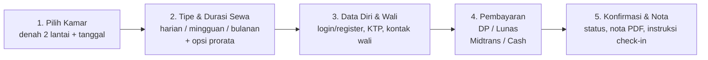
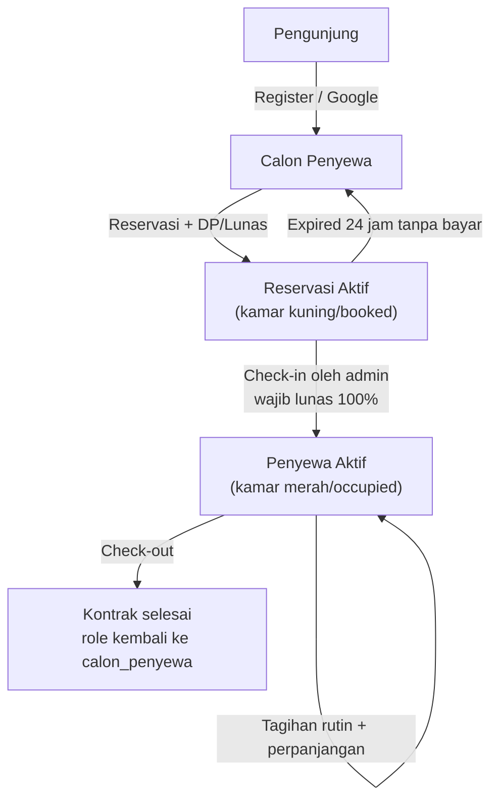
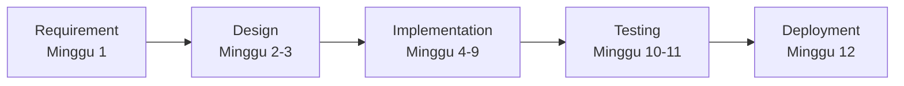

# PRD — Mini ERP Sistem Informasi Manajemen Kost ASRI BOARDING HOUSE

| Atribut | Nilai |
|---|---|
| Nama Produk | Mini ERP Kost Asri (SIM Kost ASRI BOARDING HOUSE) |
| Nama Folder Project | `Kost-Asri` (`c:\xampp\htdocs\kost-asri`) |
| Nama Database | `kost_asri` (MySQL/MariaDB via phpMyAdmin) |
| Metodologi | Waterfall (Requirement → Design → Implementation → Testing → Deployment & Maintenance) |
| Versi Dokumen | 1.0 |
| Tanggal | 08 November 2026 |
| Status | Draft untuk persetujuan (Phase Gate 1) |
| Dokumen Terkait | [Blueprint-Kost-Asri.md](../Blueprint/Blueprint-Kost-Asri.md), folder [`Task/`](../Task) |

---

## Daftar Isi
1. [Ringkasan Produk](#1-ringkasan-produk)
2. [Latar Belakang & Masalah](#2-latar-belakang--masalah)
3. [Tujuan & KPI](#3-tujuan--kpi)
4. [Profil Kost](#4-profil-kost)
5. [Persona, Role & Hak Akses](#5-persona-role--hak-akses)
6. [Ruang Lingkup](#6-ruang-lingkup)
7. [Alur Utama Sistem](#7-alur-utama-sistem)
8. [Kebutuhan Fungsional (FR)](#8-kebutuhan-fungsional-fr)
9. [Aturan Bisnis (BR)](#9-aturan-bisnis-br)
10. [Simulasi Perhitungan](#10-simulasi-perhitungan)
11. [Notifikasi & Template Pesan](#11-notifikasi--template-pesan)
12. [Chatbot WhatsApp](#12-chatbot-whatsapp)
13. [Kebutuhan Non-Fungsional (NFR)](#13-kebutuhan-non-fungsional-nfr)
14. [Gaya Desain (Ringkas)](#14-gaya-desain-ringkas)
15. [Tech Stack & Integrasi](#15-tech-stack--integrasi)
16. [Asumsi, Batasan & Risiko](#16-asumsi-batasan--risiko)
17. [Jadwal Waterfall & Phase Gate](#17-jadwal-waterfall--phase-gate)
18. [Glosarium](#18-glosarium)

---

## 1. Ringkasan Produk

Mini ERP berbasis web untuk **ASRI BOARDING HOUSE** (Tembalang, Kota Semarang) yang mengelola siklus penuh bisnis kost:

- **Pemasaran** — landing page yang seluruh kontennya dapat dikelola admin (CMS).
- **Reservasi** — online (5 langkah) maupun manual oleh admin, untuk sewa **harian, mingguan, bulanan**.
- **Penagihan** — invoice otomatis via cronjob, prorata bulanan, DP/lunas, denda 10% dengan eskalasi.
- **Pembayaran** — Midtrans Snap (sandbox) atau tunai (cash) yang dicatat admin.
- **Komunikasi** — notifikasi WhatsApp (Fonnte) & Email (SMTP) ke penyewa dan **wali**, chatbot WhatsApp berbasis aturan (tanpa LLM).
- **Dokumen** — nota reservasi, invoice, dan kwitansi PDF (DomPDF).
- **Operasional** — denah 32 kamar 2 lantai real-time, check-in/check-out, laporan okupansi & keuangan.

## 2. Latar Belakang & Masalah

| No | Masalah Saat Ini | Dampak | Solusi di Sistem |
|---|---|---|---|
| 1 | Pencatatan reservasi & pembayaran manual (buku/WA) | Data tercecer, double booking | Reservasi terpusat + validasi ketersediaan |
| 2 | Tanggal masuk penyewa berbeda-beda | Penagihan tidak seragam, sulit dipantau | Penyelarasan siklus tanggal 1–10 dengan prorata |
| 3 | Penagihan & pengingat dilakukan satu per satu | Banyak tunggakan, beban kerja penjaga | Cronjob invoice & reminder otomatis WA/Email |
| 4 | Wali tidak mengetahui keterlambatan | Tunggakan berlarut | Eskalasi otomatis ke wali (peringatan → denda) |
| 5 | Pembayaran hanya tunai | Tidak fleksibel bagi mahasiswa luar kota | Midtrans (VA, e-wallet, QRIS, kartu) + cash |
| 6 | Promosi bergantung media sosial | Info kamar/tarif tidak selalu terbaru | Landing page CMS + chatbot WA 24 jam |

## 3. Tujuan & KPI

| Tujuan | KPI | Target (6 bulan setelah go-live) |
|---|---|---|
| Meningkatkan okupansi | Okupansi rata-rata bulanan | ≥ 90% (≥ 29 dari 32 kamar) |
| Pembayaran tepat waktu | % invoice bulanan lunas ≤ tanggal 10 | ≥ 85% |
| Digitalisasi pembayaran | % pembayaran via Midtrans | ≥ 60% |
| Efisiensi admin | Waktu proses reservasi manual | ≤ 5 menit per reservasi |
| Respons calon penyewa | Pertanyaan WA terjawab otomatis oleh chatbot | ≥ 70% |
| Akurasi data | Kasus double booking | 0 kasus |

## 4. Profil Kost

| Atribut | Nilai |
|---|---|
| Nama | ASRI BOARDING HOUSE |
| Lokasi | Tembalang, Kota Semarang, Jawa Tengah (dekat kawasan kampus) |
| Jumlah Lantai | 2 |
| Jumlah Kamar | 32 |
| Kelas Kamar | Standard (16), VIP (10), Deluxe (6) |

### 4.1 Komposisi & Kode Kamar

| Lantai | Kode Kamar | Kelas | Jumlah |
|---|---|---|---:|
| 1 | 101 – 112 | Standard | 12 |
| 1 | 113 – 116 | VIP | 4 |
| 2 | 201 – 204 | Standard | 4 |
| 2 | 205 – 210 | VIP | 6 |
| 2 | 211 – 216 | Deluxe | 6 |
| | | **Total** | **32** |

### 4.2 Tarif (Placeholder — dapat diubah Admin)

| Kelas | Harian | Mingguan | Bulanan | Aksen Warna |
|---|---:|---:|---:|---|
| Standard | Rp 60.000 | Rp 300.000 | Rp 900.000 | Abu-abu |
| VIP | Rp 85.000 | Rp 450.000 | Rp 1.300.000 | Biru |
| Deluxe | Rp 120.000 | Rp 650.000 | Rp 1.800.000 | Emas |

### 4.3 Parameter Sistem (Default, dapat diubah Admin di menu Pengaturan)

| Kunci | Default | Keterangan |
|---|---|---|
| `dp_percent` | 30 | Minimal DP (%) dari total tagihan reservasi |
| `penalty_percent` | 10 | Denda (%) dari pokok sewa invoice |
| `monthly_issue_day` | 1 | Tanggal terbit tagihan bulanan |
| `monthly_due_day` | 10 | Tanggal jatuh tempo tagihan bulanan |
| `weekly_invoice_days_before` | 2 | Invoice perpanjangan mingguan terbit H-2 |
| `weekly_tolerance_days` | 1 | Toleransi keterlambatan mingguan H+1 |
| `booking_hold_hours` | 24 | Lama kamar ditahan untuk reservasi yang belum dibayar |
| `checkin_time` / `checkout_time` | 14:00 / 12:00 | Jam check-in & check-out |
| `rounding_unit` | 1 | Pembulatan nominal (Rp 1 = pembulatan rupiah terdekat) |
| `monthly_notice_days` | 7 | Pemberitahuan berhenti sewa bulanan minimal H-7 akhir bulan |

## 5. Persona, Role & Hak Akses

### 5.1 Persona

| Persona | Deskripsi | Kebutuhan Utama |
|---|---|---|
| **Pengunjung** | Belum login, mencari kost di Tembalang | Info kamar, harga, fasilitas, lokasi, cara reservasi |
| **Calon Penyewa** (`calon_penyewa`) | Sudah register (manual/Google), belum check-in | Reservasi, bayar DP/lunas, unduh nota |
| **Admin / Penjaga Kost** (`admin`) | Mengelola operasional harian | Denah kamar, reservasi manual, terima cash, check-in/out, tagihan, CMS, laporan |
| **Penyewa Aktif** (`penyewa`) | Sudah check-in dan memiliki kontrak (lease) aktif | Lihat & bayar tagihan, perpanjang, unduh kwitansi, ubah data wali |
| **Wali** | Orang tua/penanggung jawab penyewa (tidak login) | Menerima notifikasi peringatan & denda via WA/Email |

### 5.2 Tiga Modul & Jalur Pemisahan

| Modul | Prefix URL | Layout | Akses |
|---|---|---|---|
| Publik & Calon Penyewa | `/`, `/reservasi/*`, `/akun/*` | Warm Biophilic | Pengunjung, `calon_penyewa` |
| Admin (Penjaga Kost) | `/admin/*` | Clean Bento Grid | `admin` |
| Penyewa Aktif | `/penyewa/*` | Clean Bento Grid | `penyewa` |

### 5.3 Matriks Hak Akses

| Fitur | Pengunjung | Calon Penyewa | Penyewa Aktif | Admin |
|---|:-:|:-:|:-:|:-:|
| Lihat landing page | ✅ | ✅ | ✅ | ✅ |
| Cek ketersediaan kamar | ✅ | ✅ | ✅ | ✅ |
| Register / login | ✅ | — | — | — |
| Membuat reservasi online | ❌ (wajib login di langkah 3) | ✅ | ✅ (kamar tambahan tidak diizinkan; hanya perpanjang) | — |
| Membuat reservasi manual | ❌ | ❌ | ❌ | ✅ |
| Bayar via Midtrans | ❌ | ✅ | ✅ | — |
| Konfirmasi pembayaran cash | ❌ | ❌ | ❌ | ✅ |
| Lihat tagihan sendiri | ❌ | ✅ | ✅ | ✅ (semua) |
| Check-in / check-out | ❌ | ❌ | ❌ | ✅ |
| Hapus/waive denda | ❌ | ❌ | ❌ | ✅ |
| CRUD konten landing | ❌ | ❌ | ❌ | ✅ |
| Kelola kamar & tarif | ❌ | ❌ | ❌ | ✅ |
| Laporan & pengaturan | ❌ | ❌ | ❌ | ✅ |
| Kirim testimoni | ❌ | ❌ | ✅ | ✅ (moderasi) |

## 6. Ruang Lingkup

### 6.1 In-Scope
- Autentikasi manual & Google OAuth, verifikasi email, lupa password.
- CMS landing: Fasilitas, Tipe Kamar, Video YouTube, Galeri, Alur Cara Reservasi, Testimoni Penyewa, FAQ, Lokasi, Tentang Kami.
- Manajemen tipe kamar, tarif, 32 kamar, denah 2 lantai.
- Reservasi online 5 langkah & reservasi manual admin; DP/lunas; hold 24 jam.
- Billing harian, mingguan (rolling), bulanan (siklus 1–10) + prorata Opsi 1 & Opsi 2.
- Denda & eskalasi ke wali; notifikasi WA Fonnte & Email SMTP.
- Pembayaran Midtrans Snap Sandbox & cash.
- Nota/Invoice/Kwitansi PDF (DomPDF).
- Chatbot WA Fonnte rule-based.
- Cronjob via Laravel Scheduler.
- Dashboard admin & penyewa, laporan, log aktivitas & log notifikasi.

### 6.2 Out-of-Scope (Versi 1.0)
- Aplikasi mobile native; multi-cabang/multi-properti.
- Midtrans mode produksi (hanya sandbox; perpindahan ke produksi = perubahan konfigurasi).
- Refund otomatis via payment gateway (refund dilakukan manual di luar sistem).
- Akuntansi lengkap (jurnal, neraca), payroll penjaga, manajemen inventaris barang.
- Chatbot berbasis AI/LLM.
- Kunci pintu digital / IoT.

## 7. Alur Utama Sistem

### 7.1 Alur Reservasi 5 Langkah



| Langkah | Nama | Isi | Output |
|---|---|---|---|
| 1 | Pilih Kamar | Pilih tanggal masuk, filter kelas, klik kamar hijau (tersedia) di denah | `room_id`, `check_in_date` |
| 2 | Tipe & Durasi Sewa | Harian (jumlah malam), Mingguan (jumlah minggu), Bulanan (Opsi Prorata 1/2); ringkasan biaya live | `rent_type`, `duration`, `prorata_option`, rincian biaya |
| 3 | Data Diri & Wali | Login/register (manual/Google) bila belum; NIK, foto KTP, alamat asal, kampus/pekerjaan, data wali | Profil penyewa lengkap |
| 4 | Pembayaran | Pilih skema DP (≥30%) / Lunas, metode Midtrans / Cash; reservasi dibuat & kamar ditahan 24 jam | `reservation` + `invoice` + `payment` |
| 5 | Konfirmasi & Nota | Status pembayaran, unduh nota PDF, notifikasi WA & Email terkirim, instruksi check-in | Nota PDF, notifikasi |

### 7.2 Siklus Hidup Penyewa



## 8. Kebutuhan Fungsional (FR)

Format: **ID — Judul**, user story, dan acceptance criteria (AC) dalam format Given/When/Then. Prioritas: **M** = Must, **S** = Should, **C** = Could.

### 8.1 Autentikasi (AUTH)

**FR-AUTH-01 — Register manual** (M)
> Sebagai pengunjung, saya ingin mendaftar dengan email & password agar dapat melakukan reservasi.
- AC1: Given form register, When saya mengisi nama, email unik, nomor WhatsApp (format 08xx/62xx), password ≥ 8 karakter + konfirmasi, Then akun dibuat dengan role `calon_penyewa` dan email verifikasi terkirim.
- AC2: Given email sudah terdaftar, When submit, Then muncul pesan validasi "Email sudah digunakan".
- AC3: Nomor WA dinormalisasi ke format `62xxxxxxxxxx`.

**FR-AUTH-02 — Login manual** (M)
- AC1: Given kredensial benar, When login, Then diarahkan ke dashboard sesuai role (lihat FR-AUTH-05).
- AC2: Given 5 kali gagal dalam 1 menit, Then login dibatasi (rate limit) 60 detik.
- AC3: Tersedia opsi "Ingat saya".

**FR-AUTH-03 — Login/Register Google** (M)
> Sebagai pengunjung, saya ingin masuk dengan akun Google agar lebih cepat.
- AC1: Given belum punya akun, When login Google berhasil, Then akun baru dibuat (role `calon_penyewa`, `email_verified_at` terisi, `google_id` & avatar tersimpan), lalu diminta melengkapi nomor WA.
- AC2: Given email Google sama dengan akun manual yang sudah ada, Then akun ditautkan (isi `google_id`), tidak membuat akun ganda.
- AC3: Given user membatalkan consent Google, Then kembali ke halaman login dengan pesan.

**FR-AUTH-04 — Lupa password** (M)
- AC1: Link reset dikirim via Email SMTP, berlaku 60 menit.

**FR-AUTH-05 — Redirect & proteksi berbasis role** (M)
- AC1: `admin` → `/admin/dashboard`; `penyewa` → `/penyewa/dashboard`; `calon_penyewa` → `/akun/reservasi-saya`.
- AC2: Akses URL modul lain menghasilkan HTTP 403.

**FR-AUTH-06 — Pembuatan akun oleh admin** (M)
- AC1: Admin dapat membuat akun calon penyewa saat reservasi manual (walk-in) dengan password acak yang dikirim via WA/Email, atau tanpa email (hanya nomor WA).

**FR-AUTH-07 — Kelengkapan profil** (M)
- AC1: User tanpa nomor WA (hasil Google) diarahkan ke form lengkapi profil sebelum reservasi.

### 8.2 CMS Landing Page (CMS)

Seluruh item CMS memiliki: `is_published` (tampil/sembunyi), `sort_order` (urutan drag & drop), validasi gambar (jpg/png/webp, ≤ 2 MB, dikompres & dibuat thumbnail).

| ID | Konten | Field Utama | Prioritas |
|---|---|---|---|
| **FR-CMS-01** | Fasilitas | nama, ikon, deskripsi singkat, kategori (kamar/umum) | M |
| **FR-CMS-02** | Tipe Kamar | terhubung ke `room_types`: nama, kelas, tarif, fasilitas kamar, luas, foto (multi), deskripsi | M |
| **FR-CMS-03** | Video YouTube | judul, URL YouTube (divalidasi & diambil video ID), thumbnail otomatis | M |
| **FR-CMS-04** | Galeri | judul, gambar, kategori (kamar/fasilitas/lingkungan) | M |
| **FR-CMS-05** | Alur Cara Reservasi | nomor langkah, judul, deskripsi, ikon (default 5 langkah §7.1) | M |
| **FR-CMS-06** | Testimoni Penyewa | nama, foto, asal/kampus, rating 1–5, isi; status moderasi | M |
| **FR-CMS-07** | FAQ | pertanyaan, jawaban (rich text sederhana) | M |
| **FR-CMS-08** | Lokasi | alamat, embed Google Maps, koordinat, daftar tempat terdekat (kampus, minimarket, dll) + jarak | M |
| **FR-CMS-09** | Tentang Kami | judul, isi rich text, foto, visi/nilai, kontak (WA, email, jam operasional) | M |

**FR-CMS-10 — Render landing page** (M)
- AC1: Given konten `is_published = true`, Then tampil sesuai `sort_order` di section masing-masing: Hero → Tentang Kami → Fasilitas → Tipe Kamar (+ ketersediaan live) → Video → Galeri → Alur Reservasi → Testimoni → FAQ → Lokasi → CTA/Footer.
- AC2: Section tanpa konten terpublikasi disembunyikan otomatis.
- AC3: Meta SEO (title, description, Open Graph) dapat diatur admin.

### 8.3 Kamar & Ketersediaan (ROOM)

**FR-ROOM-01 — Kelola tipe kamar & tarif** (M): CRUD tipe kamar (Standard/VIP/Deluxe) dengan tarif harian, mingguan, bulanan. Perubahan tarif **tidak** mengubah invoice yang sudah terbit.

**FR-ROOM-02 — Kelola kamar** (M): CRUD 32 kamar (kode, lantai, tipe, catatan). Admin dapat menandai `maintenance`. Kamar dengan lease aktif tidak bisa dihapus.

**FR-ROOM-03 — Denah 2 lantai** (M)
- AC1: Denah menampilkan 16 kamar per lantai dalam grid, warna status: **hijau** tersedia, **kuning** dipesan/proses DP, **merah** terisi, **abu netral** maintenance.
- AC2: Setiap kamar memiliki aksen kelas (border/badge): Standard abu-abu, VIP biru, Deluxe emas.
- AC3: Admin: klik kamar → panel detail (penghuni, masa sewa, status tagihan). Publik: klik kamar hijau → mulai reservasi.

**FR-ROOM-04 — Cek ketersediaan berdasarkan tanggal** (M)
- AC1: Kamar dianggap tersedia untuk rentang [check-in, check-out) bila tidak beririsan dengan reservasi berstatus `pending_payment`, `dp_paid`, `paid`, `checked_in` atau lease `active`.

### 8.4 Reservasi (RSV)

**FR-RSV-01 — Reservasi online 5 langkah** (M): sesuai §7.1. Progress stepper dapat kembali ke langkah sebelumnya tanpa kehilangan data (disimpan di session draft).

**FR-RSV-02 — Kalkulasi biaya otomatis** (M): menghitung total sesuai BR-05, BR-08, BR-13–BR-15 dan menampilkan rincian per item sebelum konfirmasi.

**FR-RSV-03 — Skema DP atau Lunas** (M)
- AC1: DP minimal `dp_percent` × total tagihan reservasi; user boleh memasukkan nominal DP lebih besar.
- AC2: Sisa tagihan menjadi invoice `settlement` yang wajib lunas saat check-in.

**FR-RSV-04 — Hold & kedaluwarsa** (M): kamar ditahan `booking_hold_hours` jam; bila tidak ada pembayaran (DP/lunas) reservasi menjadi `expired` dan kamar kembali tersedia (BR-03).

**FR-RSV-05 — Reservasi manual oleh admin** (M)
- AC1: Admin memilih/membuat akun penyewa, kamar, tipe sewa, tanggal, skema bayar; dapat langsung mencatat pembayaran cash atau mengirim link Midtrans ke WA penyewa.
- AC2: Sumber reservasi tercatat `source = admin` beserta admin pembuat.

**FR-RSV-06 — Check-in** (M)
- AC1: Given semua invoice reservasi & settlement lunas 100%, When admin klik Check-in, Then lease `active` dibuat, kamar → `occupied` (merah), role user → `penyewa`.
- AC2: Given masih ada sisa tagihan, Then tombol Check-in terkunci dan menampilkan sisa yang harus dibayar (dapat dibayar cash saat itu juga).
- AC3: Data wali wajib lengkap untuk sewa mingguan & bulanan (BR-28).

**FR-RSV-07 — Check-out** (M): admin mengakhiri lease, kamar → `available`, role user kembali `calon_penyewa` bila tidak memiliki lease aktif lain. Checkout diblokir bila ada invoice belum lunas kecuali admin memilih "checkout dengan tunggakan" (tercatat di log).

**FR-RSV-08 — Pembatalan** (M): calon penyewa dapat membatalkan sebelum check-in; DP **tidak dikembalikan** (BR-27). Admin dapat membatalkan dengan alasan.

**FR-RSV-09 — Perpanjangan** (M)
- Harian: penyewa/admin menambah N hari → invoice `daily_extension` wajib dibayar di muka sebelum perpanjangan aktif (BR-07).
- Mingguan: invoice perpanjangan otomatis H-2 (BR-10); penyewa dapat memilih "Tidak Perpanjang".
- Bulanan: berjalan otomatis setiap tanggal 1 hingga penyewa mengajukan berhenti (BR-33).

### 8.5 Penagihan (BILL)

| ID | Judul | Ringkasan | Prioritas |
|---|---|---|---|
| **FR-BILL-01** | Billing harian | Total = malam × tarif harian; tanpa siklus tanggal 1 (BR-05–BR-07) | M |
| **FR-BILL-02** | Billing mingguan | Rolling 7 hari dari tanggal masuk; invoice perpanjangan H-2 (BR-08–BR-11) | M |
| **FR-BILL-03** | Billing bulanan | Terbit tanggal 1, jatuh tempo tanggal 10 (BR-12) | M |
| **FR-BILL-04** | Prorata Opsi 1 (Gabung) | Prorata sisa bulan masuk + 1 bulan penuh berikutnya dibayar saat reservasi (BR-14) | M |
| **FR-BILL-05** | Prorata Opsi 2 (Penuh Dulu) | 1 bulan penuh saat reservasi; tanggal 1 pertama dilewati; kekurangan prorata ditagih bersama tarif penuh tanggal 1 berikutnya (BR-15) | M |
| **FR-BILL-06** | Nomor & rincian invoice | Nomor unik (BR-30), item: sewa, prorata, denda, diskon, lain-lain | M |
| **FR-BILL-07** | Penyesuaian manual | Admin dapat menambah item lain-lain/diskon atau membatalkan (void) invoice dengan alasan, tercatat di activity log | S |

### 8.6 Pembayaran (PAY)

**FR-PAY-01 — Midtrans Snap** (M)
- AC1: Klik "Bayar" → Snap popup sandbox muncul dengan nominal sisa tagihan invoice.
- AC2: Snap token disimpan dan dipakai ulang selama belum kedaluwarsa (24 jam).

**FR-PAY-02 — Notifikasi (webhook) Midtrans** (M)
- AC1: Endpoint `POST /webhook/midtrans` memverifikasi `signature_key` (BR-24).
- AC2: Status `settlement`/`capture(accept)` → payment `paid`, invoice diperbarui, kwitansi PDF + WA + Email terkirim.
- AC3: Notifikasi ganda (duplikat) tidak menggandakan pembayaran (idempoten).
- AC4: Status `expire`/`cancel`/`deny` → payment `failed`, invoice tetap belum lunas.

**FR-PAY-03 — Pembayaran cash** (M)
- AC1: Admin mencatat pembayaran tunai (nominal, tanggal, catatan); `received_by` = admin.
- AC2: Calon penyewa yang memilih cash saat reservasi melihat instruksi "bayar ke penjaga dalam 24 jam".

**FR-PAY-04 — Pembayaran sebagian** (M): hanya untuk invoice reservasi (DP). Invoice rutin (bulanan/mingguan/perpanjangan harian) wajib dibayar penuh (BR-22).

**FR-PAY-05 — Kwitansi** (M): setiap pembayaran sukses menghasilkan kwitansi PDF yang dapat diunduh penyewa & admin.

### 8.7 Denda & Eskalasi (PEN)

**FR-PEN-01 — Eskalasi bulanan** (M): sesuai BR-17–BR-20 — siklus ke-1 bebas denda, siklus ke-2 peringatan ke wali tanpa denda, siklus ke-3 dst denda 10% + notifikasi wali.

**FR-PEN-02 — Denda mingguan** (M): invoice perpanjangan mingguan (minggu ke-2 dst) yang belum lunas melewati H+1 dikenai denda 10% + notifikasi wali (BR-11).

**FR-PEN-03 — Harian tanpa denda** (M): sewa harian tidak pernah dikenai denda & tidak ada notifikasi wali (BR-07).

**FR-PEN-04 — Pembebasan denda (waive)** (S): admin dapat menghapus item denda dengan alasan wajib; tercatat di `penalty_logs` & activity log.

### 8.8 Notifikasi (NTF)

| ID | Judul | Ringkasan | Prioritas |
|---|---|---|---|
| **FR-NTF-01** | WA ke penyewa | Konfirmasi reservasi, tagihan terbit, reminder, pembayaran sukses, check-in/out via Fonnte | M |
| **FR-NTF-02** | WA & Email ke wali | Peringatan (siklus ke-2) & denda (siklus ke-3+ / mingguan) | M |
| **FR-NTF-03** | Email SMTP | Verifikasi, reset password, nota, invoice, kwitansi (lampiran PDF), reminder | M |
| **FR-NTF-04** | Log & kirim ulang | Semua notifikasi tercatat (channel, penerima, status, respons API); admin dapat kirim ulang | M |
| **FR-NTF-05** | Notifikasi in-app | Lonceng notifikasi di dashboard admin & penyewa | S |

### 8.9 Dokumen PDF (PDF)

| ID | Dokumen | Isi |
|---|---|---|
| **FR-PDF-01** | Nota Reservasi | Kode reservasi, data penyewa, kamar & kelas, tipe sewa, periode, rincian biaya, DP/lunas, sisa, metode bayar |
| **FR-PDF-02** | Invoice | Nomor invoice, periode, item (sewa/prorata/denda), jatuh tempo, status, link/QR pembayaran |
| **FR-PDF-03** | Kwitansi | Nomor kwitansi, nominal, terbilang, metode, tanggal bayar, penerima (admin/Midtrans), cap "LUNAS" |

### 8.10 Chatbot WhatsApp (BOT)

| ID | Judul | Ringkasan | Prioritas |
|---|---|---|---|
| **FR-BOT-01** | Webhook pesan masuk | Menerima pesan dari Fonnte, validasi token, simpan log | M |
| **FR-BOT-02** | Menu keyword | Balasan otomatis berdasarkan keyword & menu angka (§12) | M |
| **FR-BOT-03** | Cek tagihan | Nomor pengirim dicocokkan dengan `users.phone`; tampilkan tagihan aktif & link bayar | M |
| **FR-BOT-04** | Handover admin | Keyword `ADMIN` → bot berhenti membalas nomor tsb 60 menit & admin diberi notifikasi | M |
| **FR-BOT-05** | Kelola keyword | Admin CRUD keyword, sinonim, & template balasan | M |

### 8.11 Dashboard, Laporan & Pengaturan (DASH)

| ID | Judul | Ringkasan | Prioritas |
|---|---|---|---|
| **FR-DASH-01** | Dashboard admin | Bento grid: okupansi, kamar per status, pendapatan bulan ini, tunggakan, check-in/out hari ini, invoice jatuh tempo, reservasi baru | M |
| **FR-DASH-02** | Laporan | Pendapatan (per periode/metode/kelas), tunggakan & denda, okupansi; filter tanggal; export PDF & CSV | M |
| **FR-DASH-03** | Dashboard penyewa | Kamar saya, masa sewa, tagihan aktif + tombol bayar, riwayat pembayaran, unduh nota | M |
| **FR-DASH-04** | Pengaturan | Ubah parameter §4.3, profil kost, kredensial integrasi (masked), template notifikasi | M |
| **FR-DASH-05** | Log aktivitas | Riwayat aksi admin (siapa, apa, kapan, data sebelum/sesudah) | S |
| **FR-DASH-06** | Manajemen penyewa | Daftar penyewa aktif/riwayat, detail profil & wali, riwayat lease & invoice | M |

### 8.12 Fitur Penyewa (TNT)

| ID | Judul | Ringkasan | Prioritas |
|---|---|---|---|
| **FR-TNT-01** | Profil & data wali | Penyewa wajib mengisi & dapat memperbarui NIK, foto KTP, alamat asal, kampus/pekerjaan, nama/HP/email/hubungan wali | M |
| **FR-TNT-02** | Riwayat tagihan | Daftar invoice & kwitansi, unduh PDF | M |
| **FR-TNT-03** | Kirim testimoni | Penyewa aktif mengirim testimoni (masuk moderasi admin, FR-CMS-06) | C |
| **FR-TNT-04** | Ajukan berhenti sewa | Penyewa bulanan mengajukan tanggal berhenti (min. H-7 akhir bulan); admin menyetujui | S |

### 8.13 Cronjob (CRON)

| ID | Command | Jadwal | Fungsi |
|---|---|---|---|
| **FR-CRON-01** | `billing:generate-monthly` | Tanggal 1, 00:05 | Terbitkan invoice bulanan semua lease bulanan aktif (termasuk kekurangan prorata Opsi 2) |
| **FR-CRON-02** | `billing:generate-weekly` | Harian 00:10 | Terbitkan invoice perpanjangan mingguan untuk lease yang berakhir H+2 |
| **FR-CRON-03** | `billing:apply-penalties` | Harian 00:30 | Tandai overdue, kirim peringatan / tambahkan denda sesuai aturan |
| **FR-CRON-04** | `notify:reminders` | Harian 08:00 | Reminder tagihan bulanan (tgl 1, 5, 9, 10) & mingguan (H-2, H-1, H) |
| **FR-CRON-05** | `reservation:expire-unpaid` | Tiap 15 menit | Expire reservasi belum dibayar melewati hold |
| **FR-CRON-06** | `payment:reconcile-midtrans` | Tiap jam | Cek status transaksi `pending` ke API Midtrans |
| **FR-CRON-07** | `stay:checkout-reminder` | Harian 09:00 | Pengingat checkout sewa harian/mingguan yang berakhir hari ini/besok ke penyewa & admin |

## 9. Aturan Bisnis (BR)

### 9.1 Umum

| ID | Aturan |
|---|---|
| **BR-01** | Satu kamar hanya boleh memiliki satu reservasi/lease aktif pada rentang tanggal yang sama (tidak boleh beririsan). Validasi dilakukan dengan database lock (`SELECT ... FOR UPDATE`) saat reservasi dibuat. |
| **BR-02** | DP minimal = `ceil(dp_percent% × total tagihan reservasi)`. Default 30%. |
| **BR-03** | Reservasi berstatus `pending_payment` ditahan `booking_hold_hours` (24 jam). Lewat waktu tanpa pembayaran → `expired`, kamar → `available`. |
| **BR-04** | Reservasi dengan metode cash juga ditahan 24 jam dan menunggu konfirmasi admin. |
| **BR-22** | Pembayaran sebagian hanya untuk invoice reservasi (DP). Invoice lain wajib dibayar penuh sesuai sisa tagihan. |
| **BR-23** | Setiap percobaan bayar Midtrans memakai `order_id` unik: `{nomor_invoice_tanpa_slash}-{unix_timestamp}`. Snap token kedaluwarsa 24 jam. |
| **BR-24** | Webhook Midtrans valid bila `signature_key = SHA512(order_id + status_code + gross_amount + server_key)`. Pemrosesan bersifat idempoten (cek status payment sebelum update). |
| **BR-25** | Status kamar: reservasi dibuat → `booked` (kuning); check-in → `occupied` (merah); check-out/expired/batal → `available` (hijau); admin dapat set `maintenance` hanya jika kamar `available`. |
| **BR-26** | Role user menjadi `penyewa` saat check-in dan kembali `calon_penyewa` saat check-out bila tidak ada lease aktif lain. |
| **BR-27** | Pembatalan reservasi: DP/pembayaran tidak dikembalikan oleh sistem (kebijakan default; refund manual di luar sistem atas kebijakan pemilik). |
| **BR-28** | Data wali (nama, HP/WA, email, hubungan) **wajib** untuk sewa mingguan & bulanan; opsional untuk harian. |
| **BR-29** | Zona waktu sistem `Asia/Jakarta` (WIB). Perbandingan jatuh tempo menggunakan tanggal (bukan jam), batas hari = 23:59:59 WIB. |
| **BR-30** | Format nomor: Reservasi `RSV-YYYYMMDD-NNNN`; Invoice `INV/ASRI/YYYY/MM/NNNN`; Kwitansi `KWT/ASRI/YYYY/MM/NNNN` (NNNN reset tiap bulan). |
| **BR-31** | Bila penyewa memiliki ≥ 2 invoice bulanan `overdue`, sistem memberi notifikasi khusus ke admin untuk tindak lanjut (tidak ada pemutusan otomatis). |
| **BR-32** | Pembulatan nominal ke `rounding_unit` terdekat (default Rp 1, round half up). Nominal ditampilkan format Rupiah `Rp 1.234.567` dengan `tabular-nums`. |

### 9.2 Sewa Harian

| ID | Aturan |
|---|---|
| **BR-05** | `total_harian = jumlah_malam × tarif_harian`, `jumlah_malam = tanggal_checkout − tanggal_checkin` (minimal 1). Tidak terikat siklus tanggal 1. |
| **BR-06** | Saat reservasi boleh DP (≥ 30%) atau lunas. **Wajib lunas 100% saat check-in.** |
| **BR-07** | Tambah hari: invoice `daily_extension` = `tambahan_malam × tarif_harian`, **wajib dibayar di muka** sebelum tanggal checkout diperpanjang (kamar harus tersedia pada tambahan tanggal). Tidak ada denda, tidak ada notifikasi wali. |

### 9.3 Sewa Mingguan

| ID | Aturan |
|---|---|
| **BR-08** | Siklus rolling 7 hari mengikuti tanggal masuk. Periode ke-k: `start_k = check_in + 7×(k−1) hari`, `end_k = start_k + 6 hari` (hari terakhir hunian). Total reservasi = `jumlah_minggu × tarif_mingguan`. |
| **BR-09** | Saat booking boleh DP (≥ 30%); seluruh minggu yang dipesan **wajib lunas saat check-in**. |
| **BR-10** | Invoice perpanjangan (`weekly`) untuk periode k+1 terbit otomatis pada **H-2** (`end_k − 2 hari`), jatuh tempo **H+1** (`end_k + 1 hari`, 23:59 WIB). Penyewa dapat memilih "Tidak Perpanjang" sebelum H → invoice dibatalkan, checkout dijadwalkan pada `end_k + 1` pukul 12:00. |
| **BR-11** | Invoice perpanjangan minggu ke-2 dst yang belum lunas setelah lewat H+1 → **denda 10% dari tarif mingguan** (sekali per invoice) + notifikasi WA & Email ke penyewa dan wali. Minggu pertama dibayar saat check-in sehingga tidak dikenai skema denda. |

### 9.4 Sewa Bulanan

| ID | Aturan |
|---|---|
| **BR-12** | Semua lease bulanan diselaraskan ke siklus: invoice terbit **tanggal 1 pukul 00:05**, jatuh tempo **tanggal 10 pukul 23:59 WIB**. |
| **BR-13** | `prorata = round(tarif_bulanan ÷ jumlah_hari_dalam_bulan × jumlah_hari_terpakai)`. Jumlah hari terpakai dihitung inklusif tanggal mulai. Jika masuk tanggal 1, tidak ada prorata. |
| **BR-14** | **Opsi 1 — Gabung di awal (`combined`)**: tagihan reservasi = `prorata(tgl_masuk s/d akhir bulan masuk) + tarif_bulanan (bulan berikutnya)`. Invoice rutin pertama terbit tanggal 1 dua bulan setelah bulan masuk. |
| **BR-15** | **Opsi 2 — Penuh dulu (`full_first`)**: tagihan reservasi = `tarif_bulanan` yang menutup periode `tgl_masuk` s/d `tgl_masuk + 1 bulan − 1 hari` (bila tanggal tidak ada di bulan berikutnya, gunakan hari terakhir bulan tsb). Tanggal 1 bulan pertama setelah masuk **dilewati** (tidak ada invoice). Invoice tanggal 1 berikutnya = `prorata(kekurangan hari dari akhir periode berbayar +1 s/d akhir bulan tsb) + tarif_bulanan (bulan berjalan)`. |
| **BR-16** | Booking awal bulanan boleh DP (≥ 30% dari tagihan reservasi); sisa wajib lunas saat check-in. |
| **BR-17** | **Siklus ke-n** = invoice bulanan rutin ke-n yang diterbitkan cron untuk lease tersebut (`cycle_index`). Untuk Opsi 1 maupun Opsi 2, invoice rutin pertama (siklus ke-1) adalah invoice tanggal 1 pertama yang benar-benar diterbitkan setelah periode yang dibayar saat reservasi. |
| **BR-18** | Denda = `penalty_percent% × pokok sewa invoice` (item `rent` + `prorata`, tidak termasuk denda/item lain), dikenakan **satu kali** per invoice, tidak berbunga. |
| **BR-19** | **Siklus ke-1** terlambat (lewat tgl 10): **bebas denda**, hanya reminder ke penyewa (keringanan bulan pertama). |
| **BR-20** | **Siklus ke-2** terlambat: **peringatan** WA & Email ke penyewa **dan wali**, tanpa denda. **Siklus ke-3 dst** terlambat: **denda 10%** ditambahkan pada tanggal 11 pukul 00:30 + notifikasi WA & Email ke penyewa dan wali. |
| **BR-21** | Jadwal reminder bulanan: tanggal 1 (tagihan terbit), 5, 9, 10 (H-0 jatuh tempo) ke penyewa saja selama belum lunas. |
| **BR-33** | Lease bulanan berjalan otomatis setiap bulan. Penyewa mengajukan berhenti minimal `monthly_notice_days` (7) hari sebelum akhir bulan; lease berakhir di hari terakhir bulan tersebut. |

### 9.5 Tabel Ringkas Perbandingan Tipe Sewa

| Aspek | Harian | Mingguan | Bulanan |
|---|---|---|---|
| Dasar hitung | Malam × tarif harian | Minggu × tarif mingguan | Prorata + tarif bulanan |
| Siklus | Tidak ada | Rolling 7 hari dari tanggal masuk | Tanggal 1–10 |
| DP saat booking | ✅ | ✅ | ✅ |
| Lunas saat check-in | Wajib 100% | Wajib 100% | Wajib 100% (tagihan reservasi) |
| Perpanjangan | Bayar di muka (manual) | Invoice otomatis H-2 | Invoice otomatis tanggal 1 |
| Jatuh tempo | Sebelum perpanjangan aktif | H+1 | Tanggal 10 |
| Denda | ❌ | 10% (minggu ke-2 dst) | Siklus 1 bebas, 2 peringatan, 3+ 10% |
| Notifikasi wali | ❌ | ✅ saat denda | ✅ siklus 2 (peringatan) & 3+ (denda) |
| Data wali | Opsional | Wajib | Wajib |

## 10. Simulasi Perhitungan

### 10.1 Harian
VIP, check-in 12 Nov 2026, check-out 15 Nov 2026 → 3 malam × Rp 85.000 = **Rp 255.000**. DP 30% = **Rp 76.500**; sisa **Rp 178.500** dibayar saat check-in. Tambah 2 malam → invoice extension **Rp 170.000** dibayar di muka.

### 10.2 Mingguan
Standard, check-in Rabu 4 Nov 2026, 1 minggu → Rp 300.000 (periode 4–10 Nov).
- Invoice perpanjangan minggu ke-2 (11–17 Nov) terbit **8 Nov** (H-2), jatuh tempo **11 Nov** (H+1).
- Belum bayar sampai 11 Nov 23:59 → **12 Nov 00:30** denda 10% × 300.000 = **Rp 30.000**; total **Rp 330.000** + WA & Email ke wali.

### 10.3 Bulanan — Opsi 1 (Gabung)
Standard Rp 900.000, masuk **15 Nov 2026** (November = 30 hari):
- Prorata 15–30 Nov = 16 hari → 900.000 ÷ 30 × 16 = **Rp 480.000**
- Desember penuh = **Rp 900.000**
- **Tagihan reservasi = Rp 1.380.000** (DP min. 30% = Rp 414.000)
- 1 Des: tidak ada invoice (sudah dibayar). **1 Jan 2027: Rp 900.000 = siklus ke-1.**

### 10.4 Bulanan — Opsi 2 (Penuh Dulu)
Standard Rp 900.000, masuk **15 Nov 2026**:
- Tagihan reservasi = **Rp 900.000** (menutup 15 Nov – 14 Des 2026; DP min. Rp 270.000)
- 1 Des: **dilewati**.
- **1 Jan 2027 (siklus ke-1)**: kekurangan 15–31 Des = 17 hari → 900.000 ÷ 31 × 17 = **Rp 493.548** + Januari **Rp 900.000** = **Rp 1.393.548**.

> Kedua opsi bertemu pada siklus yang sama mulai 1 Januari; total yang dibayar sampai akhir Januari: Opsi 1 = 1.380.000 + 900.000 = **2.280.000**, Opsi 2 = 900.000 + 1.393.548 = **2.293.548** (selisih karena basis hari Nov=30 vs Des=31).

### 10.5 Eskalasi Denda Bulanan (masuk 15 Nov 2026, Opsi 1)

| Invoice | Siklus | Jika terlambat (lewat tgl 10) |
|---|---|---|
| 1 Jan 2027 | 1 | Bebas denda, reminder ke penyewa |
| 1 Feb 2027 | 2 | Peringatan WA & Email ke penyewa + wali, tanpa denda |
| 1 Mar 2027 | 3 | Denda 10% = Rp 90.000 (total Rp 990.000) + WA & Email ke penyewa + wali |
| 1 Apr 2027 dst | 4+ | Sama seperti siklus 3 |

### 10.6 Kasus Tepi (Edge Cases) yang Wajib Ditangani

| Kasus | Perlakuan |
|---|---|
| Masuk tanggal 1 (bulanan) | Tidak ada prorata: tagihan reservasi = 1 bulan penuh (bulan berjalan), invoice rutin (siklus ke-1) mulai tanggal 1 bulan berikutnya. Pilihan Opsi 1/Opsi 2 disembunyikan. |
| Masuk 31 Jan (Opsi 2) | Periode berbayar 31 Jan – 28 Feb (akhir Feb); kekurangan 0 hari → invoice 1 Mar hanya tarif penuh. |
| Februari kabisat (2028) | Basis hari = 29. |
| Masuk setelah tanggal 10 | Tidak berpengaruh; tagihan reservasi menutup bulan berjalan (+ bulan berikut untuk Opsi 1). |
| Tarif berubah di tengah kontrak | Invoice yang sudah terbit tidak berubah; invoice berikutnya memakai tarif baru (snapshot tarif di lease bisa dikunci admin). |
| Pembayaran Midtrans masuk setelah invoice di-void | Payment ditandai `needs_review`, admin diberi notifikasi. |
| Penyewa harian ingin pindah ke bulanan | Checkout lease harian lalu reservasi baru bulanan (manual oleh admin). |

## 11. Notifikasi & Template Pesan

### 11.1 Matriks Pemicu Notifikasi

| Event | WA Penyewa | Email Penyewa | WA Wali | Email Wali | Admin (in-app) |
|---|:-:|:-:|:-:|:-:|:-:|
| Reservasi dibuat | ✅ | ✅ (nota) | — | — | ✅ |
| Pembayaran sukses | ✅ | ✅ (kwitansi) | — | — | ✅ |
| Reservasi expired | ✅ | ✅ | — | — | ✅ |
| Check-in / check-out | ✅ | ✅ | — | — | — |
| Invoice terbit (bulanan/mingguan) | ✅ | ✅ (invoice) | — | — | — |
| Reminder jatuh tempo | ✅ | ✅ | — | — | — |
| Peringatan bulanan (siklus 2) | ✅ | ✅ | ✅ | ✅ | ✅ |
| Denda bulanan (siklus 3+) | ✅ | ✅ | ✅ | ✅ | ✅ |
| Denda mingguan | ✅ | ✅ | ✅ | ✅ | ✅ |
| Pengingat checkout | ✅ | — | — | — | ✅ |
| ≥ 2 invoice overdue | — | — | — | — | ✅ |

### 11.2 Contoh Template WA

**Invoice bulanan terbit**
```
Halo {nama}, tagihan sewa kamar {kode_kamar} ({kelas}) periode {periode} telah terbit.
No. Invoice : {nomor_invoice}
Total       : {total}
Jatuh tempo : {tanggal_jatuh_tempo}
Bayar online: {link_bayar}
Atau bayar tunai ke penjaga kost.
— ASRI BOARDING HOUSE, Tembalang
```

**Peringatan ke wali (siklus ke-2)**
```
Yth. Bapak/Ibu {nama_wali},
Kami informasikan tagihan sewa {nama} kamar {kode_kamar} periode {periode}
sebesar {total} telah melewati jatuh tempo {tanggal_jatuh_tempo}.
Ini adalah PERINGATAN. Keterlambatan berikutnya akan dikenakan denda 10%.
Terima kasih — ASRI BOARDING HOUSE
```

**Denda ke wali (siklus ke-3+ / mingguan)**
```
Yth. Bapak/Ibu {nama_wali},
Tagihan sewa {nama} kamar {kode_kamar} periode {periode} terlambat dibayar.
Denda 10%   : {nominal_denda}
Total kini  : {total}
Mohon segera diselesaikan melalui {link_bayar} atau tunai ke penjaga kost.
— ASRI BOARDING HOUSE
```

Template disimpan di database dan dapat diubah admin (FR-DASH-04). Placeholder yang tersedia: `{nama}`, `{kode_kamar}`, `{kelas}`, `{periode}`, `{nomor_invoice}`, `{total}`, `{nominal_denda}`, `{tanggal_jatuh_tempo}`, `{link_bayar}`, `{nama_wali}`, `{kode_reservasi}`, `{tanggal_checkin}`, `{tanggal_checkout}`.

## 12. Chatbot WhatsApp

Rule-based (tanpa LLM): normalisasi pesan (huruf besar, trim, hapus tanda baca) → cocokkan keyword/sinonim → balas template. Pesan yang tidak dikenali → tampilkan MENU.

| Keyword / Angka | Sinonim | Balasan |
|---|---|---|
| `MENU` | halo, hai, hi, mulai, p | Daftar menu 1–7 |
| `1` / `KAMAR` | kosong, tersedia, ready | Jumlah kamar tersedia per kelas hari ini + link reservasi |
| `2` / `HARGA` | tarif, biaya, price | Tabel tarif harian/mingguan/bulanan per kelas |
| `3` / `TAGIHAN` | invoice, cek tagihan | Jika nomor terdaftar: tagihan aktif + jatuh tempo + link bayar; jika tidak: "nomor belum terdaftar" |
| `4` / `BAYAR` | pembayaran, transfer | Cara bayar (Midtrans/cash) + link invoice terbaru |
| `5` / `LOKASI` | alamat, maps | Alamat + link Google Maps |
| `6` / `FAQ` | tanya, info | 5 FAQ teratas |
| `7` / `ADMIN` | cs, penjaga, manusia | Handover: bot diam 60 menit untuk nomor ini, admin diberi notifikasi |

## 13. Kebutuhan Non-Fungsional (NFR)

| ID | Kategori | Kebutuhan |
|---|---|---|
| NFR-01 | Keamanan | Password bcrypt, CSRF, proteksi XSS (escape output), validasi server-side seluruh input, otorisasi Policy per resource (mencegah IDOR) |
| NFR-02 | Keamanan | Webhook Midtrans diverifikasi signature; webhook Fonnte diverifikasi token rahasia; kredensial hanya di `.env` |
| NFR-03 | Keamanan | Foto KTP disimpan di storage privat (bukan public), diakses via route berotorisasi |
| NFR-04 | Performa | Halaman landing < 2,5 detik (LCP) di 4G; dashboard < 1,5 detik untuk 32 kamar & ≤ 10.000 invoice |
| NFR-05 | Keandalan | Notifikasi & PDF diproses di queue (retry 3×, backoff); cron memakai `withoutOverlapping()` |
| NFR-06 | Integritas | Transaksi DB untuk reservasi & pembayaran; nominal disimpan `DECIMAL(12,2)` / integer rupiah |
| NFR-07 | Usability | Responsif mobile-first (≥ 360 px), Bahasa Indonesia, format tanggal `d MMMM yyyy`, Rupiah tabular-nums |
| NFR-08 | Aksesibilitas | Kontras warna minimal WCAG AA untuk teks; status tidak hanya dibedakan warna (ada label/ikon) |
| NFR-09 | Auditabilitas | Activity log untuk aksi admin; log notifikasi & log webhook disimpan ≥ 1 tahun |
| NFR-10 | Maintainability | Kode mengikuti PSR-12, service layer untuk logika bisnis, test otomatis untuk mesin billing (coverage ≥ 80% pada `app/Services/Billing`) |
| NFR-11 | Backup | Backup database harian (mysqldump) dengan retensi 14 hari |
| NFR-12 | Kompatibilitas | Chrome, Edge, Firefox, Safari 2 versi terakhir; Android Chrome |

## 14. Gaya Desain (Ringkas)

Detail di [Task-Desain.md](../Task/Task-Desain.md).

- **Hibrida**: *Warm Biophilic* untuk halaman publik, *Clean Bento Grid* untuk dashboard ERP.
- **Warna utama**: Deep Forest Green `#1B4332`; **aksen tombol**: Warm Terracotta `#E07A5F`.
- **Semantik status**: hijau = tersedia/lunas; kuning = proses DP/dipesan; merah = terisi/menunggak.
- **Aksen kelas**: Standard abu-abu, VIP biru, Deluxe emas.
- **Font**: Plus Jakarta Sans; angka `tabular-nums` untuk denah kamar & nominal Rupiah.

## 15. Tech Stack & Integrasi

| Lapisan | Teknologi |
|---|---|
| Backend | Laravel 12 (PHP 8.2), Inertia.js (server adapter) |
| Frontend dashboard | Vue 3 + Inertia.js + Tailwind CSS |
| Frontend publik | Blade + Alpine.js (animasi & interaksi) + Tailwind CSS |
| Database | MySQL/MariaDB 10.4 (XAMPP, phpMyAdmin) — `kost_asri` |
| Auth sosial | Google OAuth 2.0 (Google Cloud Console) via Laravel Socialite |
| Payment | Midtrans Snap (Sandbox) |
| WhatsApp | Fonnte API (kirim pesan + webhook chatbot) |
| Email | SMTP (Mailtrap untuk development, Gmail SMTP/App Password untuk produksi) |
| PDF | barryvdh/laravel-dompdf |
| Penjadwalan | Laravel Scheduler (Cronjob / Windows Task Scheduler) + Queue (database driver) |
| Testing | Pest PHP |

## 16. Asumsi, Batasan & Risiko

### 16.1 Asumsi
1. Satu kamar dihuni satu penyewa (satu akun) per lease.
2. Tarif pada §4.2 adalah placeholder dan dapat diubah sebelum go-live.
3. DP tidak dapat dikembalikan oleh sistem (BR-27).
4. Penjaga kost memiliki satu akun admin bersama atau beberapa akun admin dengan hak yang sama.
5. Nomor WA pengirim (device Fonnte) adalah nomor resmi kost dan sudah terhubung.

### 16.2 Risiko

| Risiko | Dampak | Mitigasi |
|---|---|---|
| Device Fonnte terputus | Notifikasi WA gagal | Fallback ke Email, log status, alert ke admin, tombol kirim ulang |
| Webhook tidak dapat diakses saat development lokal | Status Midtrans tidak update | Gunakan ngrok + cron `payment:reconcile-midtrans` |
| Cron tidak berjalan di server | Invoice tidak terbit | Monitoring "last run" di dashboard admin + perintah manual |
| Salah perhitungan prorata | Kerugian/keluhan penyewa | Unit test komprehensif (Task-Testing) + simulasi di QA |
| Double booking karena request bersamaan | Konflik kamar | Lock baris kamar dalam transaksi DB (BR-01) |

## 17. Jadwal Waterfall & Phase Gate

| Fase | Dokumen | Estimasi | Phase Gate (Kriteria Keluar) |
|---|---|---|---|
| 1. Requirement | PRD (dokumen ini) | 1 minggu | PRD disetujui pemilik kost; semua BR memiliki contoh angka |
| 2. Design | Blueprint, Task-Desain, Task-Database | 2 minggu | Mockup disetujui, ERD final, arsitektur & state machine disepakati |
| 3. Implementation | Task-Setup, Task-Backend, Task-API, Task-Frontend | 6 minggu | Semua task status selesai; build tanpa error; integrasi sandbox berjalan |
| 4. Testing | Task-Testing, Task-QA | 2 minggu | Seluruh test otomatis lulus; tidak ada bug Critical/High terbuka; UAT ditandatangani |
| 5. Deployment & Maintenance | Task-Setup §Deployment, Task-QA §Go-Live | 1 minggu + berkelanjutan | Aplikasi live, cron & queue berjalan, backup aktif |



## 18. Glosarium

| Istilah | Arti |
|---|---|
| Lease | Kontrak hunian aktif seorang penyewa pada satu kamar (dibuat saat check-in) |
| Invoice | Tagihan berisi item sewa/prorata/denda |
| Siklus (cycle_index) | Urutan invoice bulanan rutin ke-n pada sebuah lease |
| Prorata | Biaya sewa sebanding jumlah hari terpakai dalam satu bulan |
| DP | Down Payment / uang muka minimal 30% |
| H-2 / H+1 | 2 hari sebelum / 1 hari setelah hari terakhir masa sewa |
| Wali | Orang tua/penanggung jawab penyewa |
| Snap | Antarmuka pembayaran popup Midtrans |
| Fonnte | Penyedia API WhatsApp tidak resmi untuk kirim/terima pesan |
| Hold | Masa penahanan kamar untuk reservasi yang belum dibayar |
| Waive | Pembebasan denda oleh admin |
