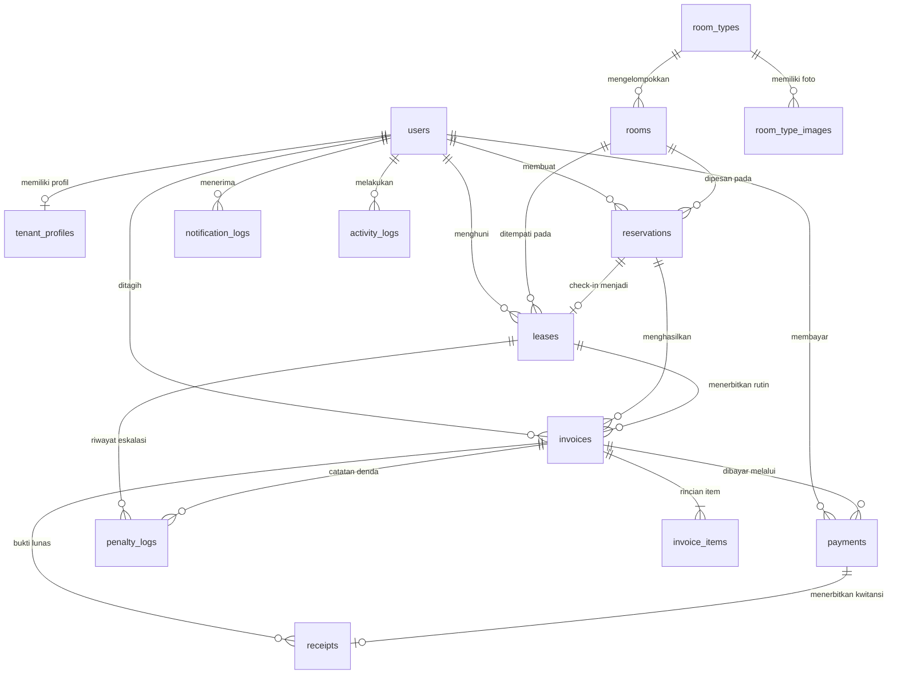
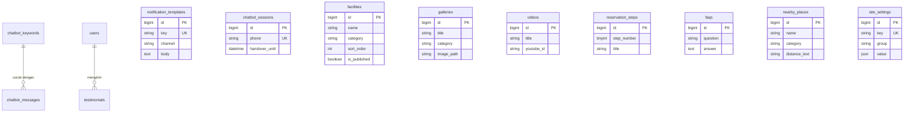

# Task — Desain & Implementasi Database (Fase 2: Design & Fase 3: Implementation)

| Atribut | Nilai |
|---|---|
| Prefix ID | `DB-` |
| Fase Waterfall | 2 — Design (ERD & Kamus Data) · 3 — Implementation (Migration, Model, Seeder) |
| Nama Database | `kost_asri` |
| Engine & Collation | InnoDB · `utf8mb4` / `utf8mb4_unicode_ci` |
| DBMS Lokal | MariaDB 10.4.32 (XAMPP, dikelola via phpMyAdmin & Artisan CLI) |
| Referensi | [PRD-Kost-Asri.md](../Documentation/PRD-Kost-Asri.md), [Blueprint-Kost-Asri.md §4–§5](../Blueprint/Blueprint-Kost-Asri.md#4-model-data-erd-ringkas) |

**Legenda kolom**: Est = estimasi jam kerja · Dep = dependensi ID task · Prioritas M/S/C.

---

## Daftar Isi
1. [Konvensi & Standar Skema](#1-konvensi--standar-skema)
2. [ERD Lengkap](#2-erd-lengkap)
3. [Kamus Data (Data Dictionary)](#3-kamus-data-data-dictionary)
4. [Strategi Indexing, Locking & Integritas](#4-strategi-indexing-locking--integritas)
5. [Spesifikasi Data Awal (Seeder)](#5-spesifikasi-data-awal-seeder)
6. [Strategi Backup & Restore](#6-strategi-backup--restore)
7. [Checklist Task (`DB-001` – `DB-040`)](#7-checklist-task-db-001--db-040)
8. [Ringkasan Estimasi & Phase Gate](#8-ringkasan-estimasi--phase-gate)

---

## 1. Konvensi & Standar Skema

| Aspek | Aturan |
|---|---|
| Nama database | `kost_asri` (snake_case, aman lintas OS Windows/Linux tanpa backtick khusus) |
| Nama tabel & kolom | `snake_case`, tabel jamak (`rooms`, `invoice_items`), FK `{singular}_id` |
| Primary key | `BIGINT UNSIGNED AUTO_INCREMENT` (`$table->id()`) |
| Nominal uang | `BIGINT` dalam satuan **Rupiah utuh** (misal `900000` untuk Rp 900.000; item diskon boleh bertanda negatif pada `invoice_items.amount`, selebihnya `BIGINT UNSIGNED`) — memenuhi NFR-06 & BR-32 tanpa galat floating-point |
| Status & tipe | `VARCHAR(32)` (bukan ENUM MySQL native) yang dipetakan ke PHP Backed Enum (`app/Enums/*`) agar penambahan status tidak membutuhkan `ALTER TABLE` berat |
| Zona waktu | Seluruh `TIMESTAMP` & `DATETIME` diasumsikan `Asia/Jakarta` (WIB, BR-29); kolom jatuh tempo & periode sewa menggunakan `DATE` |
| Data sensitif | `tenant_profiles.nik` disimpan sebagai `TEXT` menggunakan Laravel `encrypted` cast + kolom `nik_hash` (`CHAR(64)` SHA-256) bila diperlukan pencarian eksak; foto KTP disimpan path relatif ke disk privat `local` (NFR-03) |
| Penghapusan data | Tabel transaksional (`reservations`, `leases`, `invoices`, `payments`, `receipts`) **dilarang hard-delete**; gunakan status `cancelled`/`void` agar jejak audit keuangan utuh |

### SQL Pembuatan Database (phpMyAdmin / CLI)
```sql
CREATE DATABASE IF NOT EXISTS `kost_asri`
  CHARACTER SET utf8mb4
  COLLATE utf8mb4_unicode_ci;
```

---

## 2. ERD Lengkap

### 2.1 Domain Inti (Auth, Kamar, Reservasi, Billing, Pembayaran, Denda)


### 2.2 Domain Komunikasi, Chatbot & CMS


---

## 3. Kamus Data (Data Dictionary)

### 3.1 Autentikasi & Profil Penyewa

#### Tabel `users` (FR-AUTH-01..07)
| Kolom | Tipe | Null | Default | Index / FK | Keterangan |
|---|---|---|---|---|---|
| `id` | `BIGINT UNSIGNED` | NO | AI | PK | ID pengguna |
| `name` | `VARCHAR(120)` | NO | — | — | Nama lengkap |
| `email` | `VARCHAR(150)` | YES | `NULL` | UNIQUE | Email (nullable untuk akun walk-in hanya WA, FR-AUTH-06) |
| `phone` | `VARCHAR(20)` | YES | `NULL` | INDEX | Nomor WA ternormalisasi `628xxxxxxxxxx` (nullable sesaat pasca login Google pertama) |
| `role` | `VARCHAR(20)` | NO | `'calon_penyewa'` | INDEX | Enum `UserRole`: `admin`, `penyewa`, `calon_penyewa` |
| `google_id` | `VARCHAR(100)` | YES | `NULL` | UNIQUE | ID akun Google OAuth (FR-AUTH-03) |
| `avatar_url` | `VARCHAR(255)` | YES | `NULL` | — | Foto profil Google / upload |
| `email_verified_at` | `TIMESTAMP` | YES | `NULL` | — | Waktu verifikasi email |
| `password` | `VARCHAR(255)` | YES | `NULL` | — | Hash bcrypt (nullable bila murni Google OAuth) |
| `is_active` | `BOOLEAN` | NO | `1` | — | Status aktif akun |
| `remember_token` | `VARCHAR(100)` | YES | `NULL` | — | Token sesi "Ingat saya" |
| `created_at`, `updated_at` | `TIMESTAMP` | YES | `NULL` | — | Timestamps |

> Selain `users`, disertakan tabel standar Laravel `password_reset_tokens` dan `sessions` (`user_id` indexed).

#### Tabel `tenant_profiles` (FR-TNT-01, BR-28, NFR-03)
| Kolom | Tipe | Null | Default | Index / FK | Keterangan |
|---|---|---|---|---|---|
| `id` | `BIGINT UNSIGNED` | NO | AI | PK | — |
| `user_id` | `BIGINT UNSIGNED` | NO | — | UNIQUE, FK → `users.id` CASCADE | 1-to-1 dengan user |
| `nik` | `TEXT` | YES | `NULL` | — | NIK 16 digit terenkripsi (`encrypted` cast) |
| `ktp_photo_path` | `VARCHAR(255)` | YES | `NULL` | — | Path di `storage/app/private/ktp/` |
| `gender` | `VARCHAR(10)` | YES | `NULL` | — | `male` / `female` |
| `birth_date` | `DATE` | YES | `NULL` | — | Tanggal lahir |
| `origin_address` | `TEXT` | YES | `NULL` | — | Alamat asal sesuai KTP |
| `occupation` | `VARCHAR(100)` | YES | `NULL` | — | Mahasiswa / Karyawan / Umum |
| `institution_name` | `VARCHAR(150)` | YES | `NULL` | — | Nama kampus / kantor (mis. UNDIP, Polines) |
| `guardian_name` | `VARCHAR(120)` | YES | `NULL` | — | Nama wali (wajib untuk mingguan & bulanan, BR-28) |
| `guardian_phone` | `VARCHAR(20)` | YES | `NULL` | INDEX | Nomor WA wali format `628xxx` |
| `guardian_email` | `VARCHAR(150)` | YES | `NULL` | — | Email wali untuk eskalasi peringatan/denda |
| `guardian_relation` | `VARCHAR(50)` | YES | `NULL` | — | Hubungan: Ayah, Ibu, Kakak, Wali |
| `emergency_notes` | `TEXT` | YES | `NULL` | — | Catatan darurat / medis opsional |
| `created_at`, `updated_at` | `TIMESTAMP` | YES | `NULL` | — | — |

---

### 3.2 Inventaris Kamar

#### Tabel `room_types` (FR-ROOM-01, FR-CMS-02)
| Kolom | Tipe | Null | Default | Index / FK | Keterangan |
|---|---|---|---|---|---|
| `id` | `BIGINT UNSIGNED` | NO | AI | PK | — |
| `name` | `VARCHAR(80)` | NO | — | — | Nama tampilan (mis. "Kamar Standard", "Kamar VIP") |
| `slug` | `VARCHAR(90)` | NO | — | UNIQUE | Slug URL (`/kamar/vip`) |
| `room_class` | `VARCHAR(20)` | NO | — | UNIQUE | Enum `RoomClass`: `standard`, `vip`, `deluxe` |
| `daily_rate` | `BIGINT UNSIGNED` | NO | — | — | Tarif harian (Rp) |
| `weekly_rate` | `BIGINT UNSIGNED` | NO | — | — | Tarif mingguan (Rp) |
| `monthly_rate` | `BIGINT UNSIGNED` | NO | — | — | Tarif bulanan (Rp) |
| `size_m2` | `DECIMAL(5,2)` | YES | `NULL` | — | Luas kamar (m²), mis. `12.00` |
| `facilities_json` | `JSON` | YES | `NULL` | — | Daftar fasilitas spesifik tipe kamar |
| `description` | `TEXT` | YES | `NULL` | — | Deskripsi lengkap untuk landing |
| `sort_order` | `INT UNSIGNED` | NO | `0` | INDEX | Urutan tampil |
| `is_published` | `BOOLEAN` | NO | `1` | — | Tampil di landing |
| `created_at`, `updated_at` | `TIMESTAMP` | YES | `NULL` | — | — |

#### Tabel `room_type_images` (FR-CMS-02)
| Kolom | Tipe | Null | Default | Index / FK | Keterangan |
|---|---|---|---|---|---|
| `id` | `BIGINT UNSIGNED` | NO | AI | PK | — |
| `room_type_id` | `BIGINT UNSIGNED` | NO | — | FK → `room_types.id` CASCADE | — |
| `image_path` | `VARCHAR(255)` | NO | — | — | Gambar utama (WebP/JPG) |
| `thumbnail_path` | `VARCHAR(255)` | YES | `NULL` | — | Thumbnail terkompresi |
| `caption` | `VARCHAR(150)` | YES | `NULL` | — | Keterangan foto |
| `is_primary` | `BOOLEAN` | NO | `0` | — | Foto sampul kartu tipe kamar |
| `sort_order` | `INT UNSIGNED` | NO | `0` | — | — |
| `created_at`, `updated_at` | `TIMESTAMP` | YES | `NULL` | — | — |

#### Tabel `rooms` (FR-ROOM-02, FR-ROOM-03, BR-25)
| Kolom | Tipe | Null | Default | Index / FK | Keterangan |
|---|---|---|---|---|---|
| `id` | `BIGINT UNSIGNED` | NO | AI | PK | — |
| `code` | `VARCHAR(10)` | NO | — | UNIQUE | Nomor kamar: `101`–`116`, `201`–`216` |
| `floor` | `TINYINT UNSIGNED` | NO | — | INDEX | Lantai `1` atau `2` |
| `grid_row` | `TINYINT UNSIGNED` | NO | `1` | — | Baris koridor pada denah (1 atau 2) |
| `grid_col` | `TINYINT UNSIGNED` | NO | `1` | — | Kolom koridor pada denah (1–8) |
| `room_type_id` | `BIGINT UNSIGNED` | NO | — | FK → `room_types.id` RESTRICT | Kelas & tarif kamar |
| `status` | `VARCHAR(20)` | NO | `'available'` | INDEX | Enum `RoomStatus`: `available`, `booked`, `occupied`, `maintenance` |
| `maintenance_note` | `VARCHAR(255)` | YES | `NULL` | — | Alasan perbaikan bila status `maintenance` |
| `notes` | `TEXT` | YES | `NULL` | — | Catatan internal kamar |
| `created_at`, `updated_at` | `TIMESTAMP` | YES | `NULL` | — | — |

---

### 3.3 Reservasi, Kontrak Huni (Lease), Penagihan & Pembayaran

#### Tabel `reservations` (FR-RSV-01..08, BR-01..04, BR-30)
| Kolom | Tipe | Null | Default | Index / FK | Keterangan |
|---|---|---|---|---|---|
| `id` | `BIGINT UNSIGNED` | NO | AI | PK | — |
| `code` | `VARCHAR(25)` | NO | — | UNIQUE | `RSV-YYYYMMDD-NNNN` |
| `user_id` | `BIGINT UNSIGNED` | NO | — | FK → `users.id` RESTRICT | Calon penyewa |
| `room_id` | `BIGINT UNSIGNED` | NO | — | FK → `rooms.id` RESTRICT | Kamar yang dipesan |
| `rent_type` | `VARCHAR(15)` | NO | — | INDEX | `daily`, `weekly`, `monthly` |
| `prorata_option` | `VARCHAR(15)` | YES | `NULL` | — | `combined` (Opsi 1) / `full_first` (Opsi 2); `NULL` untuk harian/mingguan/masuk tgl 1 |
| `payment_scheme` | `VARCHAR(10)` | NO | — | — | `dp` atau `full` |
| `preferred_method` | `VARCHAR(15)` | NO | — | — | `midtrans` atau `cash` |
| `source` | `VARCHAR(10)` | NO | `'online'` | — | `online` atau `admin` |
| `created_by` | `BIGINT UNSIGNED` | YES | `NULL` | FK → `users.id` SET NULL | Admin pembuat bila `source = admin` |
| `check_in_date` | `DATE` | NO | — | INDEX | Tanggal rencana masuk |
| `check_out_date` | `DATE` | YES | `NULL` | INDEX | Tanggal keluar (terisi untuk harian & mingguan awal; `NULL` untuk bulanan terbuka) |
| `duration_qty` | `SMALLINT UNSIGNED` | NO | `1` | — | Jumlah malam (harian) / minggu (mingguan) / `1` (bulanan) |
| `rate_snapshot` | `BIGINT UNSIGNED` | NO | — | — | Tarif dasar saat reservasi dibuat |
| `total_amount` | `BIGINT UNSIGNED` | NO | — | — | Total tagihan awal reservasi |
| `dp_amount` | `BIGINT UNSIGNED` | NO | `0` | — | Nominal DP yang dipilih (`= total_amount` bila `full`) |
| `initial_billed_until` | `DATE` | NO | — | — | Periode awal yang ditutup tagihan reservasi (dipakai saat membuat `leases.billed_until`) |
| `status` | `VARCHAR(20)` | NO | `'pending_payment'` | INDEX | `pending_payment`, `dp_paid`, `paid`, `checked_in`, `completed`, `cancelled`, `expired` |
| `expires_at` | `DATETIME` | YES | `NULL` | INDEX | Batas hold 24 jam (BR-03) |
| `cancelled_at` | `DATETIME` | YES | `NULL` | — | Waktu pembatalan |
| `cancelled_reason` | `VARCHAR(255)` | YES | `NULL` | — | Alasan batal |
| `notes` | `TEXT` | YES | `NULL` | — | Catatan tambahan |
| `created_at`, `updated_at` | `TIMESTAMP` | YES | `NULL` | — | — |

> Composite index: `idx_rsv_room_dates (room_id, status, check_in_date, check_out_date)` untuk kueri ketersediaan kamar cepat (FR-ROOM-04).

#### Tabel `leases` (FR-RSV-06, FR-RSV-07, FR-RSV-09, BR-12..BR-20, BR-33)
| Kolom | Tipe | Null | Default | Index / FK | Keterangan |
|---|---|---|---|---|---|
| `id` | `BIGINT UNSIGNED` | NO | AI | PK | — |
| `reservation_id` | `BIGINT UNSIGNED` | NO | — | UNIQUE, FK → `reservations.id` RESTRICT | Asal reservasi |
| `user_id` | `BIGINT UNSIGNED` | NO | — | INDEX, FK → `users.id` RESTRICT | Penyewa aktif |
| `room_id` | `BIGINT UNSIGNED` | NO | — | INDEX, FK → `rooms.id` RESTRICT | Kamar yang dihuni |
| `rent_type` | `VARCHAR(15)` | NO | — | INDEX | `daily`, `weekly`, `monthly` |
| `prorata_option` | `VARCHAR(15)` | YES | `NULL` | — | `combined` / `full_first` |
| `daily_rate` | `BIGINT UNSIGNED` | NO | — | — | Snapshot tarif harian |
| `weekly_rate` | `BIGINT UNSIGNED` | NO | — | — | Snapshot tarif mingguan |
| `monthly_rate` | `BIGINT UNSIGNED` | NO | — | — | Snapshot tarif bulanan |
| `start_date` | `DATE` | NO | — | — | Tanggal mulai menghuni |
| `billed_until` | `DATE` | NO | — | INDEX | Tanggal terakhir periode yang **sudah diterbitkan invoicenya** |
| `paid_until` | `DATE` | NO | — | INDEX | Tanggal terakhir periode yang **sudah lunas** |
| `cycle_count` | `INT UNSIGNED` | NO | `0` | — | Jumlah invoice rutin yang telah terbit (`cycle_index` terakhir, BR-17) |
| `auto_renew` | `BOOLEAN` | NO | `1` | — | `0` untuk harian atau mingguan/bulanan yang memilih berhenti |
| `planned_checkout_date` | `DATE` | YES | `NULL` | INDEX | Tanggal rencana keluar (harian, mingguan stop, bulanan stop) |
| `status` | `VARCHAR(15)` | NO | `'active'` | INDEX | `active`, `ending`, `ended` |
| `checked_in_at` | `DATETIME` | NO | — | — | Waktu check-in aktual |
| `checked_out_at` | `DATETIME` | YES | `NULL` | — | Waktu check-out aktual |
| `checked_in_by` | `BIGINT UNSIGNED` | YES | `NULL` | FK → `users.id` SET NULL | Admin yang memproses check-in |
| `checked_out_by` | `BIGINT UNSIGNED` | YES | `NULL` | FK → `users.id` SET NULL | Admin yang memproses check-out |
| `checkout_notes` | `TEXT` | YES | `NULL` | — | Catatan saat keluar (termasuk jika checkout dengan tunggakan) |
| `created_at`, `updated_at` | `TIMESTAMP` | YES | `NULL` | — | — |

#### Tabel `invoices` (FR-BILL-01..07, BR-12, BR-18, BR-30)
| Kolom | Tipe | Null | Default | Index / FK | Keterangan |
|---|---|---|---|---|---|
| `id` | `BIGINT UNSIGNED` | NO | AI | PK | — |
| `number` | `VARCHAR(30)` | NO | — | UNIQUE | `INV/ASRI/YYYY/MM/NNNN` |
| `reservation_id` | `BIGINT UNSIGNED` | YES | `NULL` | FK → `reservations.id` RESTRICT | Terisi untuk `reservation` & `settlement` |
| `lease_id` | `BIGINT UNSIGNED` | YES | `NULL` | FK → `leases.id` RESTRICT | Terisi untuk `monthly`, `weekly`, `daily_extension` |
| `user_id` | `BIGINT UNSIGNED` | NO | — | INDEX, FK → `users.id` RESTRICT | Tertagih |
| `type` | `VARCHAR(20)` | NO | — | INDEX | `reservation`, `settlement`, `monthly`, `weekly`, `daily_extension` |
| `cycle_index` | `INT UNSIGNED` | YES | `NULL` | — | Urutan siklus ke-n (dipakai eskalasi denda bulanan/mingguan) |
| `period_start` | `DATE` | NO | — | — | Awal periode sewa |
| `period_end` | `DATE` | NO | — | — | Akhir periode sewa |
| `issue_date` | `DATE` | NO | — | — | Tanggal terbit |
| `due_date` | `DATE` | NO | — | INDEX | Tanggal jatuh tempo |
| `subtotal` | `BIGINT UNSIGNED` | NO | `0` | — | Jumlah pokok (`rent` + `prorata` + `other`) |
| `penalty_amount` | `BIGINT UNSIGNED` | NO | `0` | — | Total item denda aktif |
| `discount_amount` | `BIGINT UNSIGNED` | NO | `0` | — | Total potongan |
| `total` | `BIGINT UNSIGNED` | NO | `0` | — | `subtotal + penalty_amount - discount_amount` |
| `minimum_pay_amount` | `BIGINT UNSIGNED` | NO | `0` | — | Minimal pembayaran pertama (`= dp_amount` untuk reservasi skema DP, selebihnya `= total`) |
| `paid_amount` | `BIGINT UNSIGNED` | NO | `0` | — | Akumulasi pembayaran `paid` |
| `status` | `VARCHAR(15)` | NO | `'unpaid'` | INDEX | `unpaid`, `partial`, `paid`, `overdue`, `void` |
| `paid_at` | `DATETIME` | YES | `NULL` | — | Waktu lunas penuh |
| `void_reason` | `VARCHAR(255)` | YES | `NULL` | — | Alasan pembatalan invoice |
| `voided_by` | `BIGINT UNSIGNED` | YES | `NULL` | FK → `users.id` SET NULL | Admin pembatal |
| `pdf_path` | `VARCHAR(255)` | YES | `NULL` | — | Cache path PDF invoice bila sudah di-generate |
| `notes` | `TEXT` | YES | `NULL` | — | Catatan |
| `created_at`, `updated_at` | `TIMESTAMP` | YES | `NULL` | — | — |

> Index pencegahan duplikasi cron: `idx_inv_lease_period (lease_id, type, period_start)` (dicek sebelum insert agar invoice yang di-`void` masih dapat dibuat ulang bila diperlukan, sedangkan invoice aktif tidak pernah ganda).

#### Tabel `invoice_items` (FR-BILL-06, FR-BILL-07)
| Kolom | Tipe | Null | Default | Index / FK | Keterangan |
|---|---|---|---|---|---|
| `id` | `BIGINT UNSIGNED` | NO | AI | PK | — |
| `invoice_id` | `BIGINT UNSIGNED` | NO | — | FK → `invoices.id` CASCADE | — |
| `type` | `VARCHAR(15)` | NO | — | INDEX | `rent`, `prorata`, `penalty`, `discount`, `other` |
| `description` | `VARCHAR(200)` | NO | — | — | Contoh: `"Prorata 15–30 Nov 2026 (16 hari)"` |
| `qty` | `SMALLINT UNSIGNED` | NO | `1` | — | Kuantitas |
| `unit_amount` | `BIGINT` | NO | — | — | Harga satuan (negatif untuk `discount`) |
| `amount` | `BIGINT` | NO | — | — | Subtotal baris |
| `is_waived` | `BOOLEAN` | NO | `0` | — | `1` bila item denda dibebaskan admin (FR-PEN-04) |
| `created_at`, `updated_at` | `TIMESTAMP` | YES | `NULL` | — | — |

#### Tabel `payments` (FR-PAY-01..04, BR-22..BR-24)
| Kolom | Tipe | Null | Default | Index / FK | Keterangan |
|---|---|---|---|---|---|
| `id` | `BIGINT UNSIGNED` | NO | AI | PK | — |
| `invoice_id` | `BIGINT UNSIGNED` | NO | — | INDEX, FK → `invoices.id` RESTRICT | Invoice yang dibayar |
| `user_id` | `BIGINT UNSIGNED` | NO | — | FK → `users.id` RESTRICT | Pembayar |
| `method` | `VARCHAR(15)` | NO | — | INDEX | `midtrans` atau `cash` |
| `order_id` | `VARCHAR(60)` | YES | `NULL` | UNIQUE | Order ID unik Midtrans (BR-23) |
| `snap_token` | `VARCHAR(100)` | YES | `NULL` | — | Token Midtrans Snap |
| `snap_expires_at` | `DATETIME` | YES | `NULL` | — | Kedaluwarsa Snap token (+24 jam) |
| `payment_channel` | `VARCHAR(40)` | YES | `NULL` | — | Misal `bca_va`, `qris`, `gopay`, `cash` |
| `midtrans_transaction_id` | `VARCHAR(80)` | YES | `NULL` | INDEX | `transaction_id` dari Midtrans |
| `amount` | `BIGINT UNSIGNED` | NO | — | — | Nominal pembayaran |
| `status` | `VARCHAR(15)` | NO | `'pending'` | INDEX | `pending`, `paid`, `failed`, `needs_review` |
| `paid_at` | `DATETIME` | YES | `NULL` | INDEX | Waktu pembayaran sah |
| `received_by` | `BIGINT UNSIGNED` | YES | `NULL` | FK → `users.id` SET NULL | Admin penerima bila `method = cash` |
| `raw_notification` | `JSON` | YES | `NULL` | — | Payload terakhir Midtrans |
| `notes` | `VARCHAR(255)` | YES | `NULL` | — | Catatan kasir/admin |
| `created_at`, `updated_at` | `TIMESTAMP` | YES | `NULL` | — | — |

#### Tabel `receipts` (FR-PAY-05, FR-PDF-03, BR-30)
| Kolom | Tipe | Null | Default | Index / FK | Keterangan |
|---|---|---|---|---|---|
| `id` | `BIGINT UNSIGNED` | NO | AI | PK | — |
| `number` | `VARCHAR(30)` | NO | — | UNIQUE | `KWT/ASRI/YYYY/MM/NNNN` |
| `payment_id` | `BIGINT UNSIGNED` | NO | — | UNIQUE, FK → `payments.id` RESTRICT | 1 pembayaran sah = 1 kwitansi |
| `invoice_id` | `BIGINT UNSIGNED` | NO | — | FK → `invoices.id` RESTRICT | — |
| `user_id` | `BIGINT UNSIGNED` | NO | — | FK → `users.id` RESTRICT | — |
| `amount` | `BIGINT UNSIGNED` | NO | — | — | Nominal kwitansi |
| `issued_at` | `DATETIME` | NO | — | — | Tanggal terbit kwitansi |
| `pdf_path` | `VARCHAR(255)` | YES | `NULL` | — | Path file PDF kwitansi |
| `created_at`, `updated_at` | `TIMESTAMP` | YES | `NULL` | — | — |

#### Tabel `penalty_logs` (FR-PEN-01..04, BR-17..BR-20)
| Kolom | Tipe | Null | Default | Index / FK | Keterangan |
|---|---|---|---|---|---|
| `id` | `BIGINT UNSIGNED` | NO | AI | PK | — |
| `invoice_id` | `BIGINT UNSIGNED` | NO | — | INDEX, FK → `invoices.id` RESTRICT | — |
| `lease_id` | `BIGINT UNSIGNED` | YES | `NULL` | FK → `leases.id` RESTRICT | — |
| `cycle_index` | `INT UNSIGNED` | YES | `NULL` | — | Siklus ke-n saat dievaluasi |
| `action` | `VARCHAR(15)` | NO | — | INDEX | `reminder` (siklus 1), `warning` (siklus 2), `penalty` (siklus 3+ / mingguan), `waived` |
| `amount` | `BIGINT UNSIGNED` | NO | `0` | — | Nominal denda (`0` untuk reminder/warning) |
| `reason` | `VARCHAR(255)` | YES | `NULL` | — | Alasan waive oleh admin |
| `acted_by` | `BIGINT UNSIGNED` | YES | `NULL` | FK → `users.id` SET NULL | `NULL` bila cron otomatis; ID admin bila `waived` |
| `guardian_notified_at` | `DATETIME` | YES | `NULL` | — | Bukti waktu notifikasi wali dikirim |
| `created_at`, `updated_at` | `TIMESTAMP` | YES | `NULL` | — | — |

#### Tabel `number_sequences` (BR-30)
| Kolom | Tipe | Null | Default | Index / FK | Keterangan |
|---|---|---|---|---|---|
| `id` | `BIGINT UNSIGNED` | NO | AI | PK | — |
| `doc_type` | `VARCHAR(15)` | NO | — | UNIQUE(`doc_type`,`period`) | `RSV`, `INV`, `KWT` |
| `period` | `VARCHAR(10)` | NO | — | — | `YYYYMMDD` untuk RSV, `YYYYMM` untuk INV & KWT |
| `last_number` | `INT UNSIGNED` | NO | `0` | — | Di-increment dengan `SELECT ... FOR UPDATE` |
| `updated_at` | `TIMESTAMP` | YES | `NULL` | — | — |

---

### 3.4 Notifikasi, Chatbot & Webhook

#### Tabel `notification_templates` (FR-DASH-04, PRD §11.2)
| Kolom | Tipe | Null | Default | Index / FK | Keterangan |
|---|---|---|---|---|---|
| `id` | `BIGINT UNSIGNED` | NO | AI | PK | — |
| `key` | `VARCHAR(50)` | NO | — | UNIQUE(`key`,`channel`) | Misal `invoice_issued`, `guardian_warning`, `guardian_penalty` |
| `name` | `VARCHAR(100)` | NO | — | — | Nama ramah admin |
| `channel` | `VARCHAR(15)` | NO | — | — | `whatsapp` atau `email` |
| `subject` | `VARCHAR(150)` | YES | `NULL` | — | Subjek (khusus `email`) |
| `body` | `TEXT` | NO | — | — | Isi pesan dengan placeholder `{nama}`, `{total}`, dll |
| `available_placeholders` | `JSON` | YES | `NULL` | — | Petunjuk variabel yang valid |
| `is_active` | `BOOLEAN` | NO | `1` | — | — |
| `created_at`, `updated_at` | `TIMESTAMP` | YES | `NULL` | — | — |

#### Tabel `notification_logs` (FR-NTF-01..04)
| Kolom | Tipe | Null | Default | Index / FK | Keterangan |
|---|---|---|---|---|---|
| `id` | `BIGINT UNSIGNED` | NO | AI | PK | — |
| `user_id` | `BIGINT UNSIGNED` | YES | `NULL` | INDEX, FK → `users.id` SET NULL | Penyewa terkait |
| `recipient_role` | `VARCHAR(15)` | NO | — | — | `tenant`, `guardian`, `admin` |
| `recipient_name` | `VARCHAR(120)` | YES | `NULL` | — | Nama penerima |
| `recipient_address` | `VARCHAR(150)` | NO | — | INDEX | Nomor WA atau alamat email |
| `channel` | `VARCHAR(15)` | NO | — | INDEX | `whatsapp` / `email` |
| `template_key` | `VARCHAR(50)` | YES | `NULL` | — | Kunci template |
| `subject` | `VARCHAR(150)` | YES | `NULL` | — | — |
| `message` | `TEXT` | NO | — | — | Isi pesan final yang dikirim |
| `attachment_path` | `VARCHAR(255)` | YES | `NULL` | — | Lampiran PDF bila ada |
| `notifiable_context_type` | `VARCHAR(80)` | YES | `NULL` | INDEX(morph) | Model terkait (`Invoice`, `Reservation`, `Payment`) |
| `notifiable_context_id` | `BIGINT UNSIGNED` | YES | `NULL` | — | ID model terkait |
| `status` | `VARCHAR(15)` | NO | `'queued'` | INDEX | `queued`, `sent`, `failed` |
| `provider_response` | `JSON` | YES | `NULL` | — | Respons API Fonnte / error SMTP |
| `retry_count` | `TINYINT UNSIGNED` | NO | `0` | — | Jumlah percobaan |
| `sent_at` | `DATETIME` | YES | `NULL` | — | — |
| `created_at`, `updated_at` | `TIMESTAMP` | YES | `NULL` | — | — |

> Tabel `notifications` bawaan Laravel tetap dibuat (`php artisan make:notifications-table`) untuk lonceng in-app (`FR-NTF-05`).

#### Tabel `chatbot_keywords` (FR-BOT-02, FR-BOT-05)
| Kolom | Tipe | Null | Default | Index / FK | Keterangan |
|---|---|---|---|---|---|
| `id` | `BIGINT UNSIGNED` | NO | AI | PK | — |
| `keyword` | `VARCHAR(40)` | NO | — | UNIQUE | Kata utama kapital (`MENU`, `KAMAR`, `HARGA`, `TAGIHAN`, `BAYAR`, `LOKASI`, `FAQ`, `ADMIN`) |
| `menu_number` | `VARCHAR(5)` | YES | `NULL` | INDEX | Angka menu (`1`–`7`) |
| `synonyms` | `JSON` | YES | `NULL` | — | Array sinonim (`["kosong","tersedia","ready"]`) |
| `action` | `VARCHAR(20)` | NO | `'static'` | — | `menu`, `availability`, `prices`, `invoice`, `pay`, `faq`, `handover`, `static` |
| `reply_template` | `TEXT` | YES | `NULL` | — | Template balasan (wajib untuk `static`, header/footer untuk dinamis) |
| `sort_order` | `INT UNSIGNED` | NO | `0` | — | — |
| `is_active` | `BOOLEAN` | NO | `1` | — | — |
| `created_at`, `updated_at` | `TIMESTAMP` | YES | `NULL` | — | — |

#### Tabel `chatbot_sessions` & `chatbot_messages` (FR-BOT-01, FR-BOT-04)
- **`chatbot_sessions`**: `id`, `phone` (`VARCHAR(20)` UNIQUE), `last_keyword` (`VARCHAR(40)` nullable), `handover_until` (`DATETIME` nullable — saat aktif bot diam 60 menit), `created_at`, `updated_at`.
- **`chatbot_messages`**: `id`, `phone` (`VARCHAR(20)` INDEX), `direction` (`in`/`out`), `message` (`TEXT`), `matched_keyword_id` (`FK → chatbot_keywords.id SET NULL`), `created_at`.

#### Tabel `webhook_logs` (NFR-02, NFR-09)
- Kolom: `id`, `provider` (`midtrans`/`fonnte`, INDEX), `event_key` (`VARCHAR(80)` nullable, mis. `order_id`), `signature_valid` (`BOOLEAN`), `processed` (`BOOLEAN`), `payload` (`JSON`), `error_message` (`TEXT` nullable), `ip_address` (`VARCHAR(45)`), `created_at`.

---

### 3.5 CMS Landing Page (FR-CMS-01..10)

| Tabel | FR | Kolom Utama |
|---|---|---|
| `facilities` | FR-CMS-01 | `id`, `name` (100), `icon` (50), `description` (255, nullable), `category` (`room`/`general`), `sort_order`, `is_published`, timestamps |
| `galleries` | FR-CMS-04 | `id`, `title` (120), `category` (`room`/`facility`/`environment`), `image_path` (255), `thumbnail_path` (255), `sort_order`, `is_published`, timestamps |
| `videos` | FR-CMS-03 | `id`, `title` (150), `youtube_url` (255), `youtube_id` (20), `thumbnail_url` (255), `description` (TEXT nullable), `sort_order`, `is_published`, timestamps |
| `reservation_steps` | FR-CMS-05 | `id`, `step_number` (`TINYINT`), `title` (100), `description` (TEXT), `icon` (50), `sort_order`, `is_published`, timestamps |
| `testimonials` | FR-CMS-06, FR-TNT-03 | `id`, `user_id` (nullable FK → `users.id` SET NULL), `name` (100), `avatar_path` (255 nullable), `origin_info` (100, mis. `"Mahasiswa Teknik UNDIP"`), `rating` (`TINYINT` 1–5), `content` (TEXT), `moderation_status` (`pending`/`approved`/`rejected`), `approved_by` (nullable FK), `sort_order`, `is_published`, timestamps |
| `faqs` | FR-CMS-07 | `id`, `question` (255), `answer` (TEXT), `sort_order`, `is_published`, timestamps |
| `nearby_places` | FR-CMS-08 | `id`, `name` (120), `category` (`campus`/`minimarket`/`culinary`/`health`/`worship`/`transport`), `distance_text` (30, mis. `"650 m"`), `travel_minutes` (`TINYINT` nullable), `sort_order`, `is_published`, timestamps |
| `site_settings` | FR-CMS-08, FR-CMS-09, FR-CMS-10 | `id`, `key` (`VARCHAR(60)` UNIQUE), `group` (`about`/`location`/`contact`/`seo`/`hero`), `value` (`JSON`), `updated_at` — menyimpan judul & narasi Tentang Kami, visi/nilai, foto, alamat lengkap Tembalang, iframe/koordinat Google Maps, kontak WA/email/jam layanan, meta title/description/OG image |

---

### 3.6 Sistem, Pengaturan & Audit

- **`settings`** (FR-DASH-04, PRD §4.3): `id`, `key` (`VARCHAR(60)` UNIQUE), `value` (`TEXT`), `type` (`int`/`string`/`bool`/`json`), `group` (`billing`/`reservation`/`system`/`cron`), `description` (`VARCHAR(255)`), `updated_at`.
- **`activity_logs`** (FR-DASH-05, NFR-09): `id`, `actor_id` (nullable FK → `users.id` SET NULL), `action` (`VARCHAR(60)` INDEX, mis. `invoice.voided`, `penalty.waived`, `lease.checked_in`), `auditable_type` (`VARCHAR(80)`), `auditable_id` (`BIGINT UNSIGNED`), `description` (`VARCHAR(255)`), `before_data` (`JSON` nullable), `after_data` (`JSON` nullable), `ip_address` (`VARCHAR(45)`), `user_agent` (`VARCHAR(255)` nullable), `created_at` (INDEX).
- **Tabel infrastruktur Laravel 12**: `jobs`, `job_batches`, `failed_jobs`, `cache`, `cache_locks`.

---

## 4. Strategi Indexing, Locking & Integritas

1. **Pencegahan Double Booking (BR-01)**:
   - Saat `CreateReservationAction` dijalankan, lakukan `Room::whereKey($roomId)->lockForUpdate()->firstOrFail()` di dalam `DB::transaction()`.
   - Cek konflik terhadap:
     - `reservations` dengan `status IN ('pending_payment', 'dp_paid', 'paid', 'checked_in')` yang rentang `[check_in_date, COALESCE(check_out_date, '9999-12-31'))` beririsan dengan rentang permintaan.
     - `leases` dengan `status IN ('active', 'ending')` yang rentang `[start_date, COALESCE(planned_checkout_date, '9999-12-31'))` beririsan.
2. **Penomoran Dokumen Atomik (BR-30)**:
   - Service `NumberSequence::next('INV', '202611')` memakai `SELECT ... FOR UPDATE` pada `number_sequences` di dalam transaksi yang sama dengan pembuatan dokumen agar nomor berurutan tanpa celah duplikat.
3. **Integritas Pembayaran & Invoice (BR-24)**:
   - Saat webhook Midtrans atau pencatatan cash masuk, kunci baris `Invoice::whereKey($id)->lockForUpdate()` sebelum menjumlahkan `paid_amount`, sehingga notifikasi paralel tidak menyebabkan `paid_amount > total`.
4. **Aturan `ON DELETE`**:
   - Tabel master & transaksi (`users`, `room_types`, `rooms`, `reservations`, `leases`, `invoices`, `payments`) memakai `RESTRICT` agar data historis keuangan tidak pernah ikut terhapus.
   - Tabel anak komposisi murni (`invoice_items`, `room_type_images`, `tenant_profiles`) memakai `CASCADE`.
   - Referensi aktor admin (`created_by`, `received_by`, `voided_by`, `acted_by`) memakai `SET NULL`.

---

## 5. Spesifikasi Data Awal (Seeder)

### 5.1 `RoomTypeSeeder` & `RoomSeeder` (32 Kamar — PRD §4.1 & §4.2)
| Lantai | Kode | Tipe (`room_class`) | Baris Denah (`grid_row`) | Kolom (`grid_col`) | Tarif Harian / Mingguan / Bulanan |
|---|---|---|---:|---|---:|
| 1 | `101` – `108` | `standard` | 1 | 1 – 8 | 60.000 / 300.000 / 900.000 |
| 1 | `109` – `112` | `standard` | 2 | 1 – 4 | 60.000 / 300.000 / 900.000 |
| 1 | `113` – `116` | `vip` | 2 | 5 – 8 | 85.000 / 450.000 / 1.300.000 |
| 2 | `201` – `204` | `standard` | 1 | 1 – 4 | 60.000 / 300.000 / 900.000 |
| 2 | `205` – `208` | `vip` | 1 | 5 – 8 | 85.000 / 450.000 / 1.300.000 |
| 2 | `209` – `210` | `vip` | 2 | 1 – 2 | 85.000 / 450.000 / 1.300.000 |
| 2 | `211` – `216` | `deluxe` | 2 | 3 – 8 | 120.000 / 650.000 / 1.800.000 |

Total terverifikasi: Standard = 12 + 4 = **16**, VIP = 4 + 6 = **10**, Deluxe = **6** → **32 kamar**.

### 5.2 Seeder Lainnya
- **`SettingSeeder`**: seluruh parameter PRD §4.3 (`dp_percent=30`, `penalty_percent=10`, `monthly_issue_day=1`, `monthly_due_day=10`, `weekly_invoice_days_before=2`, `weekly_tolerance_days=1`, `booking_hold_hours=24`, `checkin_time=14:00`, `checkout_time=12:00`, `rounding_unit=1`, `monthly_notice_days=7`).
- **`AdminSeeder`**: akun default `admin@asriboardinghouse.id` (role `admin`, email terverifikasi; password dari env `INITIAL_ADMIN_PASSWORD` atau default dev `Password123!`) + 2 akun contoh dev (`penyewa@example.com`, `calon@example.com`) hanya saat `APP_ENV=local`.
- **`NotificationTemplateSeeder`**: seluruh template WA & Email untuk event di PRD §11.1–§11.2.
- **`ChatbotKeywordSeeder`**: 8 entri (`MENU` + nomor `1`–`7`) lengkap beserta sinonim PRD §12.
- **`CmsSeeder`**: fasilitas umum & kamar, 5 langkah alur reservasi, 6 FAQ umum kost Tembalang, 3 testimoni awal, lokasi Tembalang Semarang + 5 tempat terdekat (UNDIP Tembalang, Polines, RS Nasional Diponegoro, minimarket, kuliner), dan konten Tentang Kami.

---

## 6. Strategi Backup & Restore (NFR-11)

- **Otomatis Harian**: Command `backup:database` menjalankan `mysqldump` ke `storage/app/private/backups/kost_asri_YYYY-MM-DD.sql.gz` setiap pukul `02:00` WIB dan menghapus arsip berusia > 14 hari.
- **Manual via phpMyAdmin (XAMPP)**: pilih database `kost_asri` → tab **Export** → metode *Custom* → centang *Add DROP TABLE*, format SQL, kompresi gzipped.
- **Uji Restore**: wajib diuji minimal sekali pada DB sementara `kost_asri_restore_test` sebelum go-live.

---

## 7. Checklist Task (`DB-001` – `DB-040`)

### 7.1 Persiapan & Desain Skema
- [x] **DB-001 — Buat database `kost_asri` di MySQL/MariaDB** · Est 0.5j · Dep: — · M
  - Buat DB `kost_asri` dengan collation `utf8mb4_unicode_ci` via phpMyAdmin / CLI; verifikasi koneksi dari `.env`.
- [x] **DB-002 — Finalisasi diagram ERD & review relasi FK** · Est 2j · Dep: DB-001 · M
  - Review seluruh relasi §2 & aturan `ON DELETE` §4 bersama tim backend.
- [x] **DB-003 — Buat seluruh PHP Backed Enum di `app/Enums`** · Est 2j · Dep: DB-002 · M
  - Implementasi 15 Enum sesuai Blueprint §5 lengkap dengan helper method `label()`, `color()`, dan `icon()`.

### 7.2 Migrations — Auth, Kamar & Transaksi
- [x] **DB-004 — Migration `users`, `password_reset_tokens`, `sessions`** · Est 1j · Dep: DB-003 · M
  - Sesuaikan tabel `users` bawaan Laravel dengan kolom `phone`, `role`, `google_id`, `avatar_url`, `is_active`, serta `email` & `password` nullable.
- [x] **DB-005 — Migration `tenant_profiles`** · Est 1j · Dep: DB-004 · M
  - Kolom identitas, KTP privat, dan data wali lengkap (§3.1).
- [x] **DB-006 — Migration `room_types` & `room_type_images`** · Est 1j · Dep: DB-003 · M
  - Tarif harian/mingguan/bulanan `BIGINT UNSIGNED`, `room_class` unique, tabel foto multi-gambar.
- [x] **DB-007 — Migration `rooms`** · Est 1j · Dep: DB-006 · M
  - Kolom `code` unique, `floor`, `grid_row`, `grid_col`, `room_type_id`, `status`.
- [x] **DB-008 — Migration `reservations`** · Est 1.5j · Dep: DB-004, DB-007 · M
  - Seluruh kolom §3.3 + composite index `idx_rsv_room_dates`.
- [x] **DB-009 — Migration `leases`** · Est 1.5j · Dep: DB-008 · M
  - Snapshot tarif, `billed_until`, `paid_until`, `cycle_count`, `auto_renew`, `planned_checkout_date`.
- [x] **DB-010 — Migration `invoices` & `invoice_items`** · Est 2j · Dep: DB-009 · M
  - Kolom pokok, denda, diskon, `minimum_pay_amount`, `paid_amount`, index `idx_inv_lease_period`, serta detail baris item.
- [x] **DB-011 — Migration `payments` & `receipts`** · Est 1.5j · Dep: DB-010 · M
  - Dukungan Midtrans (`order_id` unique, `snap_token`) & cash (`received_by`), serta tabel kwitansi 1-to-1.
- [x] **DB-012 — Migration `penalty_logs` & `number_sequences`** · Est 1j · Dep: DB-010 · M
  - Pencatatan eskalasi siklus 1/2/3+ & counter penomoran dokumen atomik.

### 7.3 Migrations — Komunikasi, Chatbot, CMS & Sistem
- [x] **DB-013 — Migration `notification_templates`, `notification_logs`, `notifications`** · Est 1.5j · Dep: DB-004 · M
  - Template WA/Email, log pengiriman + retry, dan tabel notifikasi in-app Laravel.
- [x] **DB-014 — Migration `chatbot_keywords`, `chatbot_sessions`, `chatbot_messages`** · Est 1j · Dep: DB-003 · M
  - Struktur rule-based keyword, sinonim JSON, dan sesi handover 60 menit.
- [x] **DB-015 — Migration `webhook_logs`** · Est 0.5j · Dep: DB-001 · M
  - Audit payload mentah Midtrans & Fonnte.
- [x] **DB-016 — Migration CMS: `facilities`, `galleries`, `videos`, `reservation_steps`** · Est 1.5j · Dep: DB-001 · M
  - Lengkap dengan `sort_order` dan `is_published`.
- [x] **DB-017 — Migration CMS: `testimonials`, `faqs`, `nearby_places`, `site_settings`** · Est 1.5j · Dep: DB-004 · M
  - Moderasi testimoni penyewa, FAQ, tempat terdekat, dan key-value JSON Tentang Kami / Lokasi / SEO.
- [x] **DB-018 — Migration sistem: `settings`, `activity_logs`, `jobs`, `cache`** · Est 1j · Dep: DB-004 · M
  - Parameter sistem dinamis, jejak audit admin, queue database.

### 7.4 Eloquent Models, Casts & Relationships
- [x] **DB-019 — Model `User` & `TenantProfile`** · Est 1.5j · Dep: DB-005 · M
  - Cast `role => UserRole::class`, `nik => 'encrypted'`, accessor normalisasi nomor WA `62xxx`, helper `isAdmin()`, `isActiveTenant()`.
- [x] **DB-020 — Model `RoomType`, `RoomTypeImage`, `Room`** · Est 1.5j · Dep: DB-007 · M
  - Scope `availableBetween($start, $end)` (FR-ROOM-04), relasi lease aktif & reservasi aktif.
- [x] **DB-021 — Model `Reservation` & `Lease`** · Est 2j · Dep: DB-009 · M
  - Cast tanggal & Enum, relasi ke `Room`, `User`, `Invoice`, `PenaltyLog`, scope `active()`, `expiring()`.
- [x] **DB-022 — Model `Invoice`, `InvoiceItem`, `Payment`, `Receipt`, `PenaltyLog`** · Est 2.5j · Dep: DB-012 · M
  - Accessor `remaining_amount`, helper `recalculateTotals()`, pengecekan `isSettled()`.
- [x] **DB-023 — Model Komunikasi & Chatbot (`NotificationTemplate`, `NotificationLog`, `ChatbotKeyword`, `ChatbotSession`, `ChatbotMessage`, `WebhookLog`)** · Est 1.5j · Dep: DB-015 · M.
- [x] **DB-024 — Model CMS & Sistem (`Facility`, `Gallery`, `Video`, `ReservationStep`, `Testimonial`, `Faq`, `NearbyPlace`, `SiteSetting`, `Setting`, `ActivityLog`)** · Est 2j · Dep: DB-018 · M
  - Scope `publishedOrdered()` untuk seluruh model CMS.
- [x] **DB-025 — Helper `NumberSequence` & `Money`** · Est 1.5j · Dep: DB-012 · M
  - Generator nomor `RSV`/`INV`/`KWT` ber-lock (BR-30) dan utilitas pembulatan & terbilang Bahasa Indonesia (BR-32).

### 7.5 Seeders & Factories
- [x] **DB-026 — `SettingSeeder`** · Est 1j · Dep: DB-024 · M — isi seluruh parameter PRD §4.3.
- [x] **DB-027 — `RoomTypeSeeder` & `RoomSeeder` (32 kamar)** · Est 1.5j · Dep: DB-020 · M
  - Seed 3 kelas kamar & 32 kamar sesuai tabel §5.1 lengkap koordinat `grid_row` & `grid_col`.
- [x] **DB-028 — `AdminSeeder`** · Est 0.5j · Dep: DB-019 · M — akun admin utama + akun sampel lokal.
- [x] **DB-029 — `NotificationTemplateSeeder`** · Est 1.5j · Dep: DB-023 · M — seluruh template WA & Email PRD §11.
- [x] **DB-030 — `ChatbotKeywordSeeder`** · Est 1j · Dep: DB-023 · M — menu `MENU` & angka `1`–`7` beserta sinonim PRD §12.
- [x] **DB-031 — `CmsSeeder`** · Est 2j · Dep: DB-024 · M — data awal realistis 9 section landing ASRI Boarding House Tembalang.
- [x] **DB-032 — Susun urutan `DatabaseSeeder` idempoten** · Est 0.5j · Dep: DB-026..DB-031 · M
  - Gunakan `updateOrCreate` agar aman dijalankan ulang tanpa menduplikasi master data.
- [x] **DB-033 — Model Factories untuk seluruh entitas inti** · Est 3j · Dep: DB-022 · M
  - `UserFactory`, `TenantProfileFactory`, `RoomTypeFactory`, `RoomFactory`, `ReservationFactory`, `LeaseFactory`, `InvoiceFactory`, `PaymentFactory` dengan state siap pakai untuk Pest (`Task-Testing.md`).
- [x] **DB-034 — `DemoTransactionSeeder` (khusus dev/QA)** · Est 2j · Dep: DB-033 · S
  - Contoh kamar berstatus tersedia (hijau), dipesan DP (kuning), terisi lunas, dan terisi menunggak (merah) agar dashboard & denah langsung bisa diuji visual.

### 7.6 Verifikasi, Optimasi & Backup
- [x] **DB-035 — Uji `php artisan migrate:fresh --seed` bersih tanpa error** · Est 0.5j · Dep: DB-032 · M
  - AC: 32 kamar terbentuk tepat (16 Standard, 10 VIP, 6 Deluxe; 16 Lt.1, 16 Lt.2).
- [x] **DB-036 — Audit `EXPLAIN` kueri kritikal** · Est 1.5j · Dep: DB-034 · M
  - Cek `EXPLAIN` pada kueri ketersediaan kamar, generator invoice bulanan, pencarian tunggakan, dan laporan pendapatan; pastikan tidak ada full table scan pada tabel transaksi.
- [x] **DB-037 — Uji constraint FK (`RESTRICT` vs `CASCADE`)** · Est 1j · Dep: DB-035 · M
  - Verifikasi kamar dengan reservasi/lease tidak bisa dihapus di level DB.
- [x] **DB-038 — Uji enkripsi kolom `tenant_profiles.nik`** · Est 0.5j · Dep: DB-019 · M
  - Pastikan nilai mentah di phpMyAdmin berupa ciphertext terenkripsi, sedangkan via Eloquent terbaca 16 digit asli.
- [x] **DB-039 — Implementasi command `backup:database` & retensi 14 hari** · Est 1.5j · Dep: DB-035 · M
  - Mendukung path `mysqldump` XAMPP Windows (`c:\xampp\mysql\bin\mysqldump.exe`) maupun Linux produksi via `.env` (`MYSQLDUMP_PATH`).
- [x] **DB-040 — Uji simulasi restore backup ke database uji** · Est 1j · Dep: DB-039 · M
  - AC: file dump berhasil di-restore utuh ke `kost_asri_restore_test` tanpa kehilangan relasi.

---

## 8. Ringkasan Estimasi & Phase Gate

| Kelompok | Task | Total Est |
|---|---|---:|
| Persiapan & desain skema | DB-001 – DB-003 | 4.5 j |
| Migrations inti & pendukung | DB-004 – DB-018 | 19.5 j |
| Models, casts & helper | DB-019 – DB-025 | 12.5 j |
| Seeders & factories | DB-026 – DB-034 | 13.0 j |
| Verifikasi, optimasi & backup | DB-035 – DB-040 | 6.0 j |
| **Total** | **40 task** | **55.5 j** |

### Phase Gate Database (Definition of Done)
- [x] ERD & kamus data mencakup seluruh kebutuhan `FR-*` dan `BR-*` di PRD.
- [x] `php artisan migrate:fresh --seed` berjalan sukses di MariaDB 10.4.32 pada DB `kost_asri`.
- [x] Komposisi 32 kamar, 3 tipe kamar, parameter sistem, keyword chatbot, dan template notifikasi terisi lengkap.
- [x] Seluruh factory siap digunakan oleh suite pengujian otomatis (`Task-Testing.md`).
- [x] Mekanisme backup harian teruji dan dapat di-restore.

