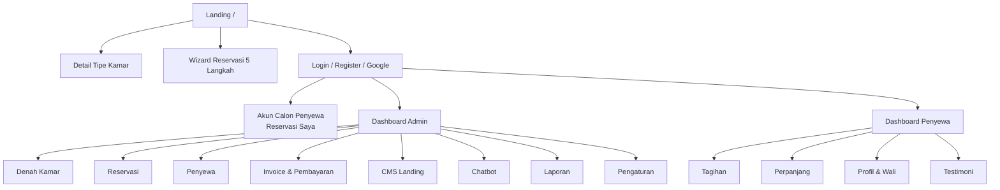

# Task — Desain UI/UX (Fase 2: Design)

| Atribut | Nilai |
|---|---|
| Prefix ID | `DSN-` |
| Fase Waterfall | 2 — Design |
| Referensi | [PRD §14](../Documentation/PRD-Kost-Asri.md#14-gaya-desain-ringkas), [Blueprint §5 Enum & Status](../Blueprint/Blueprint-Kost-Asri.md#5-enum--status) |
| Tools | Figma (atau Penpot), Tailwind CSS 4 `@theme` untuk implementasi token |
| Output | Design system, wireframe, mockup hi-fi, prototype klik, spesifikasi komponen |

**Legenda kolom**: Est = estimasi jam kerja · Dep = dependensi ID task · Prioritas M/S/C.

---

## 1. Konsep Desain Hibrida

| Area | Gaya | Karakter | Halaman |
|---|---|---|---|
| Publik | **Warm Biophilic** | Hangat, alami, menenangkan: latar cream, bentuk organik (radius besar, blob), foto natural/tanaman, ilustrasi daun tipis, bayangan lembut, animasi reveal halus | Landing page, detail tipe kamar, wizard reservasi, login/register |
| ERP | **Clean Bento Grid** | Rapi, padat informasi, mudah dipindai: kartu modular berbagai ukuran dalam grid, latar putih/abu sangat muda, border tipis, radius sedang, minim dekorasi | Dashboard Admin, Dashboard Penyewa, semua halaman manajemen |

Benang merah kedua gaya: warna primer Deep Forest Green, aksen Warm Terracotta, font Plus Jakarta Sans, dan sistem warna semantik yang sama.

## 2. Design Token

### 2.1 Warna Merek & Netral

| Token | Hex | Penggunaan |
|---|---|---|
| `forest-900` (**primary**) | `#1B4332` | Header, sidebar dashboard, judul, tombol sekunder solid |
| `forest-700` | `#2D6A4F` | Hover primary, ikon aktif |
| `forest-500` | `#40916C` | Aksen garis, link pada latar terang |
| `sage-300` | `#95D5B2` | Ornamen daun, highlight lembut |
| `sage-100` | `#D8F3DC` | Latar section alternatif landing |
| `terracotta-500` (**aksen CTA**) | `#E07A5F` | Tombol utama "Reservasi Sekarang", "Bayar" |
| `terracotta-600` | `#C8553D` | Hover CTA |
| `terracotta-700` | `#B5482F` | Teks/link terracotta di latar terang (kontras AA) |
| `terracotta-100` | `#FBE3DC` | Latar badge/aksen lembut |
| `cream-50` | `#FAF7F0` | Latar halaman publik |
| `sand-100` | `#F2EBDD` | Kartu publik, divider organik |
| `slate-50` | `#F8FAFC` | Latar dashboard |
| `ink-900` | `#1F2937` | Teks utama |
| `ink-500` | `#6B7280` | Teks sekunder |
| `line-200` | `#E5E7EB` | Border kartu bento |

### 2.2 Warna Semantik Status (kontras tinggi, wajib disertai label/ikon)

| Makna | Token | Solid | Latar | Teks | Dipakai untuk |
|---|---|---|---|---|---|
| Tersedia / Lunas | `success` | `#16A34A` | `#DCFCE7` | `#14532D` | `RoomStatus.available`, `InvoiceStatus.paid`, `PaymentStatus.paid` |
| Proses DP / Dipesan / Sebagian | `warning` | `#EAB308` | `#FEF9C3` | `#713F12` | `RoomStatus.booked`, `InvoiceStatus.partial`, `ReservationStatus.dp_paid`, `PaymentStatus.pending` |
| Terisi / Menunggak | `danger` | `#DC2626` | `#FEE2E2` | `#7F1D1D` | `RoomStatus.occupied`, `InvoiceStatus.overdue` |
| Netral / Perbaikan / Batal | `neutral` | `#64748B` | `#F1F5F9` | `#334155` | `RoomStatus.maintenance`, `void`, `expired`, `cancelled` |

### 2.3 Aksen Kelas Kamar

| Kelas | Token | Solid | Latar | Penerapan |
|---|---|---|---|---|
| Standard | `class-standard` | `#6B7280` (abu-abu) | `#F3F4F6` | Border kiri 4px kartu kamar, badge "STD", ikon |
| VIP | `class-vip` | `#2563EB` (biru) | `#DBEAFE` | Border kiri 4px, badge "VIP", ikon bintang |
| Deluxe | `class-deluxe` | `#C9A227` (emas) | `#FBF3D5` | Border kiri 4px + gradasi tipis emas, badge "DLX", ikon mahkota |

> **Aturan kombinasi**: warna *status* mengisi latar/fill sel kamar, warna *kelas* tampil sebagai border kiri + badge. Dengan begitu satu sel kamar menyampaikan dua informasi tanpa bentrok.

### 2.4 Catatan Kontras (WCAG AA)

| Kombinasi | Perkiraan Rasio | Status | Rekomendasi |
|---|---|---|---|
| Putih di atas `forest-900` | ± 11 : 1 | ✅ AA/AAA | Aman untuk semua ukuran |
| Putih di atas `terracotta-500` `#E07A5F` | ± 3,0 : 1 | ⚠️ Kurang untuk teks normal | Teks tombol CTA memakai `ink-900` (± 4,9 : 1) **atau** latar `terracotta-700` + teks putih (± 5,3 : 1) untuk tombol kecil |
| `forest-900` di atas `terracotta-500` | ± 3,7 : 1 | ⚠️ Hanya teks besar | Hindari untuk teks < 18px |
| `terracotta-700` di atas `cream-50` | ± 5 : 1 | ✅ AA | Dipakai untuk link aksen |

> Rasio di atas adalah perkiraan; wajib diverifikasi ulang dengan contrast checker pada DSN-006.

### 2.5 Tipografi

| Token | Ukuran / Line-height | Berat | Penggunaan |
|---|---|---|---|
| `display` | 48/56 (mobile 36/44) | 800 | Hero landing |
| `h1` | 36/44 | 700 | Judul halaman |
| `h2` | 28/36 | 700 | Judul section |
| `h3` | 20/28 | 600 | Judul kartu bento |
| `body` | 16/24 | 400 | Paragraf |
| `small` | 14/20 | 500 | Label, tabel |
| `caption` | 12/16 | 600 | Badge, meta |
| `kpi` | 32/40 | 700 + `tabular-nums` | Angka KPI dashboard |

- Font: **Plus Jakarta Sans** (variable, 200–800) via `@fontsource-variable/plus-jakarta-sans`, fallback `ui-sans-serif, system-ui`.
- **`font-variant-numeric: tabular-nums`** wajib untuk: nominal Rupiah, nomor kamar pada denah, tanggal di tabel, KPI, kolom angka tabel (rata kanan).
- Format Rupiah: `Rp 1.380.000` (spasi setelah Rp, titik ribuan, tanpa desimal).

### 2.6 Spasi, Radius, Bayangan

| Token | Publik (Biophilic) | Dashboard (Bento) |
|---|---|---|
| Radius kartu | 24px (`rounded-3xl`), blob/organic mask untuk foto | 16px (`rounded-2xl`) |
| Radius tombol | full (pill) | 10px |
| Bayangan | `0 10px 30px -10px rgba(27,67,50,.25)` | `0 1px 2px rgba(0,0,0,.05)` + border `line-200` |
| Grid | 12 kolom, max-width 1200px | Bento 4 kolom (desktop) / 2 (tablet) / 1 (mobile), gap 16px |
| Spasi dasar | 8px scale | 4px scale |

### 2.7 Implementasi Token (rujukan untuk FE)
```css
/* resources/css/tokens.css — di-import oleh app.css & public.css */
@theme {
  --font-sans: "Plus Jakarta Sans Variable", ui-sans-serif, system-ui, sans-serif;
  --color-forest-900: #1B4332;  --color-forest-700: #2D6A4F;  --color-forest-500: #40916C;
  --color-sage-300: #95D5B2;    --color-sage-100: #D8F3DC;
  --color-terracotta-500: #E07A5F; --color-terracotta-600: #C8553D;
  --color-terracotta-700: #B5482F; --color-terracotta-100: #FBE3DC;
  --color-cream-50: #FAF7F0;    --color-sand-100: #F2EBDD;
  --color-success: #16A34A;     --color-success-bg: #DCFCE7;
  --color-warning: #EAB308;     --color-warning-bg: #FEF9C3;
  --color-danger: #DC2626;      --color-danger-bg: #FEE2E2;
  --color-neutral: #64748B;     --color-neutral-bg: #F1F5F9;
  --color-class-standard: #6B7280; --color-class-vip: #2563EB; --color-class-deluxe: #C9A227;
}
.num { font-variant-numeric: tabular-nums; }
```

## 3. Pola Animasi (Alpine.js — halaman publik)

| Pola | Plugin/Teknik | Spesifikasi |
|---|---|---|
| Reveal on scroll | `@alpinejs/intersect` (`x-intersect.once`) | fade + translateY 24px → 0, 500ms, ease-out, stagger 80ms antar kartu |
| Accordion FAQ | `@alpinejs/collapse` (`x-collapse`) | 250ms, ikon plus berputar 45° |
| Slider testimoni | `x-data` + interval 6s, pause on hover | geser horizontal, indikator titik |
| Lightbox galeri | `x-show` + `x-transition` | backdrop blur, navigasi panah & keyboard |
| Counter angka (32 kamar, dll) | `x-intersect` + requestAnimationFrame | 1s, `tabular-nums` agar lebar tidak bergoyang |
| Navbar sticky | `x-data` scroll listener | transparan → cream solid + bayangan setelah 80px |
| Hover kartu kamar | CSS transition | naik 4px, bayangan bertambah, 200ms |
| Video modal | `x-show` lazy-load iframe YouTube | iframe hanya dimuat saat dibuka (performa) |

Hormati `prefers-reduced-motion: reduce` → nonaktifkan transform, gunakan fade saja.

## 4. Peta Halaman (Sitemap)



---

## 5. Checklist Task

### 5.1 Fondasi Design System

- [ ] **DSN-001 — Moodboard Warm Biophilic & Clean Bento** · Est 4j · Dep: — · M
  - Kumpulkan 15–20 referensi (Dribbble/Behance/Mobbin) untuk landing biophilic & dashboard bento.
  - AC: moodboard disetujui pemilik kost; arah foto (kamar terang, tanaman, kayu) ditetapkan.
- [ ] **DSN-002 — Palet warna merek & netral** · Est 2j · Dep: DSN-001 · M
  - Buat color styles Figma sesuai §2.1.
- [ ] **DSN-003 — Warna semantik status** · Est 2j · Dep: DSN-002 · M
  - Style §2.2 + mapping ke setiap enum status (Blueprint §5).
  - AC: setiap status memiliki pasangan warna + ikon + label teks.
- [ ] **DSN-004 — Aksen kelas kamar** · Est 2j · Dep: DSN-002 · M
  - Badge STD/VIP/DLX, border kiri, ikon (§2.3); uji kombinasi dengan 4 status kamar (12 kombinasi).
- [ ] **DSN-005 — Tipografi & tabular-nums** · Est 2j · Dep: DSN-001 · M
  - Text styles §2.5; contoh tabel nominal Rupiah & denah dengan tabular-nums vs proportional sebagai pembanding.
- [ ] **DSN-006 — Audit kontras WCAG AA** · Est 2j · Dep: DSN-003, DSN-004 · M
  - Verifikasi semua kombinasi teks/latar §2.4 dengan contrast checker; putuskan final gaya teks tombol CTA terracotta.
  - AC: tidak ada teks < 18px dengan rasio < 4,5 : 1.
- [ ] **DSN-007 — Grid, spasi, radius, bayangan** · Est 2j · Dep: DSN-001 · M
  - Token §2.6, layout grid publik 12 kolom & bento 4/2/1 kolom.
- [ ] **DSN-008 — Ikonografi & ilustrasi** · Est 4j · Dep: DSN-001 · S
  - Set ikon Lucide untuk fasilitas (wifi, AC, kamar mandi dalam, parkir, dapur, laundry, CCTV, dll); ornamen daun SVG untuk landing.
- [ ] **DSN-009 — Dokumentasi token untuk developer** · Est 2j · Dep: DSN-002..DSN-007 · M
  - Ekspor token ke format `@theme` (§2.7), serahkan ke FE-002.

### 5.2 Komponen UI (Component Library)

- [ ] **DSN-010 — Tombol** · Est 2j · Dep: DSN-009 · M — varian primary (terracotta), secondary (forest), ghost, danger; ukuran sm/md/lg; state hover/focus/disabled/loading.
- [ ] **DSN-011 — Input & form** · Est 3j · Dep: DSN-009 · M — text, select, date picker, upload KTP (preview), input Rupiah (prefix Rp, tabular-nums), error & helper text.
- [ ] **DSN-012 — StatusBadge** · Est 1j · Dep: DSN-003 · M — pill dengan dot/ikon + label, untuk semua status.
- [ ] **DSN-013 — RoomClassBadge** · Est 1j · Dep: DSN-004 · M.
- [ ] **DSN-014 — Sel kamar (RoomCell)** · Est 3j · Dep: DSN-012, DSN-013 · M
  - Kotak ±88×88px: nomor kamar besar tabular-nums, fill warna status, border kiri warna kelas, ikon kecil status; state hover, selected, disabled (publik untuk non-tersedia).
- [ ] **DSN-015 — BentoCard** · Est 2j · Dep: DSN-007 · M — ukuran 1×1, 2×1, 2×2; header ikon + judul + aksi; varian KPI (angka besar + tren).
- [ ] **DSN-016 — Tabel data** · Est 3j · Dep: DSN-005 · M — header sticky, kolom angka rata kanan tabular-nums, baris status berwarna, paginasi, filter, empty state.
- [ ] **DSN-017 — Modal, drawer, toast, confirm dialog** · Est 2j · Dep: DSN-010 · M.
- [ ] **DSN-018 — Stepper 5 langkah** · Est 2j · Dep: DSN-010 · M — horizontal (desktop) / ringkas "Langkah 2 dari 5" (mobile), state done/active/upcoming.
- [ ] **DSN-019 — Ringkasan biaya (PriceSummary)** · Est 2j · Dep: DSN-005 · M — daftar item, subtotal, DP minimal, sisa; sticky di sisi kanan (desktop) / bottom sheet (mobile).
- [ ] **DSN-020 — Navigasi** · Est 3j · Dep: DSN-009 · M — navbar publik (sticky, menu mobile), sidebar dashboard admin (forest-900, collapsible), bottom nav dashboard penyewa (mobile).

### 5.3 Wireframe (Low-Fidelity)

- [ ] **DSN-021 — Wireframe landing page** · Est 6j · Dep: DSN-007 · M
  - Urutan section: Hero → Tentang Kami → Fasilitas → Tipe Kamar (+ ketersediaan) → Video YouTube → Galeri → Alur Reservasi → Testimoni → FAQ → Lokasi → CTA + Footer (FR-CMS-10).
- [ ] **DSN-022 — Wireframe wizard reservasi 5 langkah** · Est 6j · Dep: DSN-018 · M
  - Step 1 denah + filter tanggal/kelas; Step 2 pilihan tipe sewa (kartu) + kalkulator + pilihan Opsi Prorata dengan penjelasan & contoh; Step 3 form data diri & wali; Step 4 pilih DP/Lunas + metode; Step 5 sukses + unduh nota.
- [ ] **DSN-023 — Wireframe auth** · Est 2j · Dep: DSN-007 · M — login, register, tombol "Masuk dengan Google", lupa password, lengkapi profil.
- [ ] **DSN-024 — Wireframe dashboard admin** · Est 6j · Dep: DSN-015 · M — bento: okupansi, kamar per status, pendapatan bulan ini, tunggakan, check-in/out hari ini, jatuh tempo, reservasi terbaru, status cron.
- [ ] **DSN-025 — Wireframe denah 2 lantai (admin & publik)** · Est 4j · Dep: DSN-014 · M — tab/segmented Lantai 1 / Lantai 2, 16 sel per lantai (grid 8×2 menyerupai koridor), legenda status & kelas, panel detail kamar.
- [ ] **DSN-026 — Wireframe modul admin lainnya** · Est 8j · Dep: DSN-016 · M — reservasi (list + form manual), detail reservasi (check-in), lease & check-out, penyewa, invoice (detail + item + void + waive), pembayaran cash, CMS (list + form + reorder) untuk 9 konten, chatbot keyword, log notifikasi, laporan, pengaturan & template.
- [ ] **DSN-027 — Wireframe dashboard penyewa** · Est 4j · Dep: DSN-015 · M — kartu kamar saya, masa sewa & "dibayar sampai", tagihan aktif + bayar, riwayat, perpanjang, profil & wali.
- [ ] **DSN-028 — Review wireframe dengan pemilik kost** · Est 2j · Dep: DSN-021..DSN-027 · M — AC: catatan revisi terdokumentasi & disetujui.

### 5.4 Mockup Hi-Fi & Prototype

- [ ] **DSN-029 — Mockup landing (desktop & mobile)** · Est 10j · Dep: DSN-028 · M — gaya Warm Biophilic penuh: hero foto + blob mask, ornamen daun, kartu tipe kamar dengan aksen kelas & badge ketersediaan, CTA terracotta.
- [ ] **DSN-030 — Mockup wizard reservasi** · Est 8j · Dep: DSN-028 · M — termasuk state error (kamar baru saja dipesan orang lain), loading Snap, sukses/gagal bayar.
- [ ] **DSN-031 — Mockup dashboard admin (Bento)** · Est 10j · Dep: DSN-028 · M.
- [ ] **DSN-032 — Mockup denah kamar** · Est 4j · Dep: DSN-028 · M — uji keterbacaan: admin harus bisa menghitung kamar per status dalam < 5 detik.
- [ ] **DSN-033 — Mockup modul admin (CRUD, invoice, laporan)** · Est 12j · Dep: DSN-031 · M.
- [ ] **DSN-034 — Mockup dashboard penyewa** · Est 6j · Dep: DSN-028 · M.
- [ ] **DSN-035 — State kosong, error, loading, 403/404/500** · Est 3j · Dep: DSN-029 · M — ilustrasi biophilic untuk publik, sederhana untuk dashboard.
- [ ] **DSN-036 — Prototype klik alur utama** · Est 4j · Dep: DSN-029..DSN-034 · S — (1) reservasi online sampai nota, (2) admin reservasi manual + cash + check-in, (3) penyewa bayar tagihan bulanan.

### 5.5 Desain Dokumen & Pesan

- [ ] **DSN-037 — Template nota reservasi PDF (A5/A4)** · Est 3j · Dep: DSN-005 · M — kop logo ASRI, warna forest, tabel rincian tabular-nums, status DP/LUNAS (FR-PDF-01).
- [ ] **DSN-038 — Template invoice PDF** · Est 2j · Dep: DSN-037 · M — periode, item, denda ditandai merah, jatuh tempo, QR/link bayar (FR-PDF-02).
- [ ] **DSN-039 — Template kwitansi PDF** · Est 2j · Dep: DSN-037 · M — terbilang, cap "LUNAS" hijau (FR-PDF-03).
- [ ] **DSN-040 — Template email (Markdown mail)** · Est 3j · Dep: DSN-002 · M — header forest, tombol terracotta, footer alamat Tembalang.
- [ ] **DSN-041 — Format pesan WhatsApp** · Est 2j · Dep: — · M — finalisasi template PRD §11.2 & menu chatbot §12 (gunakan *tebal* WA, emoji secukupnya, maks 1.000 karakter).
- [ ] **DSN-042 — Template laporan PDF** · Est 2j · Dep: DSN-037 · S.

### 5.6 Handoff

- [ ] **DSN-043 — Spesifikasi responsif** · Est 2j · Dep: DSN-029..DSN-034 · M — breakpoint 360 / 640 / 768 / 1024 / 1280; perilaku denah di mobile (scroll horizontal per lantai atau grid 4×4).
- [ ] **DSN-044 — Spesifikasi aksesibilitas** · Est 2j · Dep: DSN-006 · M — fokus terlihat (ring forest-500 2px), urutan tab, aria-label sel kamar ("Kamar 113, VIP, Terisi"), status tidak hanya warna.
- [ ] **DSN-045 — Handoff ke developer** · Est 3j · Dep: semua di atas · M — link Figma dev mode, ekspor aset (SVG ikon/ornamen, foto WebP), daftar komponen → nama komponen Vue/Blade.

---

## 6. Ringkasan Estimasi

| Kelompok | Task | Total Est |
|---|---|---:|
| Fondasi design system | DSN-001 – DSN-009 | 22 j |
| Komponen UI | DSN-010 – DSN-020 | 24 j |
| Wireframe | DSN-021 – DSN-028 | 38 j |
| Mockup & prototype | DSN-029 – DSN-036 | 57 j |
| Dokumen & pesan | DSN-037 – DSN-042 | 14 j |
| Handoff | DSN-043 – DSN-045 | 7 j |
| **Total** | **45 task** | **162 j (± 4 minggu, 1 desainer)** |

## 7. Phase Gate Desain (Definition of Done)

- [ ] Seluruh mockup hi-fi desktop & mobile disetujui pemilik kost (tanda tangan/approval tertulis).
- [ ] Token warna, tipografi, spasi terdokumentasi dan diserahkan (DSN-009).
- [ ] Audit kontras lulus (DSN-006) dan spesifikasi aksesibilitas tersedia (DSN-044).
- [ ] Template PDF, email, dan WA final.
- [ ] Tidak ada pertanyaan desain terbuka yang memblokir implementasi.

